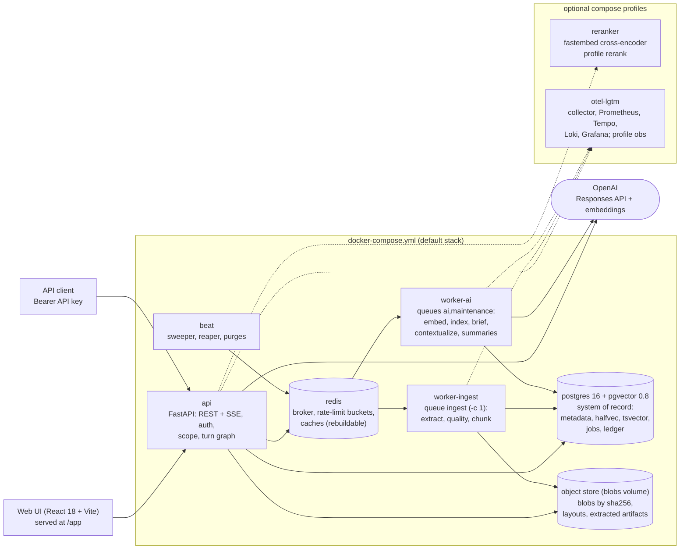
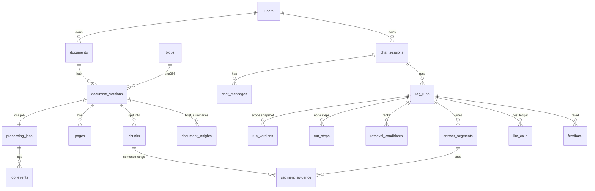
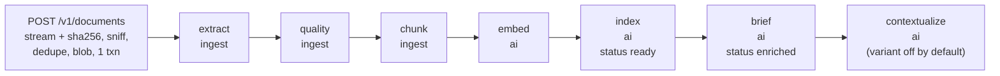
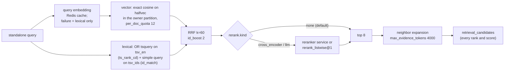
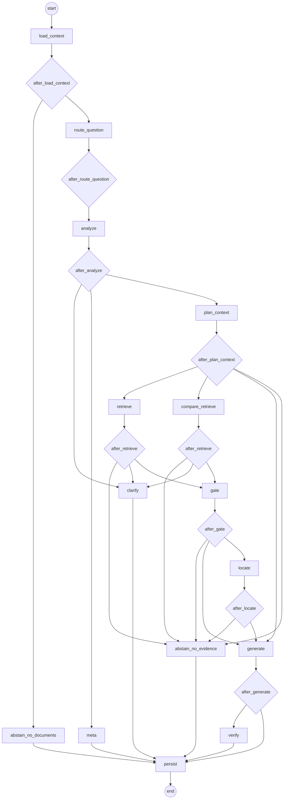

# Vault architecture

How Vault is built, why each part exists, which models do what, and how any answer can be explained. This file describes the code on `main` as of 2026-11-14. Where it disagrees with `docs/design.md` (the original design specification), the code wins, and the difference is listed in [section 12](#12-decisions-trade-offs-and-known-gaps). Every number carries its source. Anything not measured is labelled **unmeasured**.

## TL;DR

1. Vault lets a user upload PDF, DOCX, TXT and Markdown files and chat with them. Every claim in an answer points to the exact stored sentence it came from.
2. Citations are **application-managed**. Each evidence sentence gets a handle (`E3.1`), the model returns handles in a strict JSON schema, and code copies `cited_text` from the stored sentence. The model never writes a quote.
3. Orchestration is code. A typed turn graph (`backend/app/chat/turn.py`) picks every edge. The model only returns typed decisions (an intent, handles, verdicts) that code validates and applies.
4. One FastAPI API process, Celery workers on three queues (`ingest`, `ai`, `maintenance`), and PostgreSQL 16 with pgvector as the single source of truth. Redis holds rebuildable state only. The reranker and observability are optional sidecars.
5. Ingestion runs `extract → quality → chunk → embed → index → brief → contextualize`. Job state lives in `processing_jobs`, with compare-and-set (CAS) claims, leases and fenced commits, so at-least-once delivery has exactly-once effects.
6. Retrieval is hybrid and exact: an OR tsquery plus `text-embedding-3-small` vectors over the owner's hash partition, fused with RRF. The cross-encoder rerank and the evidence gate are **off by default** because measurements did not justify them.
7. Models are addressed by role: `fast` = `gpt-6-luna`, `balanced` = `gpt-6.1-terra`, `deep` = `gpt-6.1-sol`, `flagship` = `gpt-6-astra`. Only `backend/app/llm/routing.py` and settings name models.
8. Explanations come from reason codes and templates (`backend/app/explain/templates.py`), served at `GET /v1/runs/{id}`. The model is never asked to explain itself.
9. Quality is measured on golden set v2: 316 items, 15 strata, document-level splits, claim-level judges, and clustered CIs. First train run: answer_pass 0.642, citation_integrity 1.000 (`docs/STATUS.md` §3). The gold set and the judges are not yet human-reviewed.
10. Seven accuracy and voice changes are built but **off** until a paired A/B on the dev split accepts them. The rule is in `docs/plan/S22.md`, the tooling in `make eval-gate`.

## Contents

1. [What Vault is and the principles behind it](#1-what-vault-is-and-the-principles-behind-it)
2. [System map](#2-system-map)
3. [Data model](#3-data-model)
4. [Ingestion pipeline](#4-ingestion-pipeline)
5. [Retrieval](#5-retrieval)
6. [Chat turn graph](#6-chat-turn-graph)
7. [Models, prompts and feature flags](#7-models-prompts-and-feature-flags)
8. [Reasoning and explainability](#8-reasoning-and-explainability)
9. [Security and idempotency](#9-security-and-idempotency)
10. [Evaluation and quality](#10-evaluation-and-quality)
11. [Scale and operations](#11-scale-and-operations)
12. [Decisions, trade-offs and known gaps](#12-decisions-trade-offs-and-known-gaps)
13. [Repo map and how to run it](#13-repo-map-and-how-to-run-it)

---

## 1. What Vault is and the principles behind it

The user is a professional with a growing personal collection of contracts, reports, policies and papers. Their jobs are to understand a new document fast, find a fact and verify it, compare documents, know when the documents do not answer something, and notice when something changed (`docs/design.md` §1.2). Research pass 1 (`docs/research/01-user-research.md`) found that "chat with your PDF" tools lose trust through wrong-page citations, trimmed context, silently merged stale or conflicting documents, and confident wrong answers. Each principle below targets one of those failures.

| Principle (from `CLAUDE.md` hard rules) | Why |
|---|---|
| Every model call goes through `app.llm.gateway`. | One place for routing, retries, budgets, the cost ledger and telemetry redaction. A stray client would make cost and behaviour unattributable. |
| Citations are application-managed: the model returns handles, and code validates them and copies `cited_text` from stored sentences. An unknown handle is dropped (`CITATION_UNRESOLVED`). | A model cannot invent a quote, and the pipeline does not depend on any provider's citation feature. |
| Only `chunks.original_text` is evidence. Prefixes and summaries are never cited. | Generated text (headers, briefs) could be wrong. Only stored document text may back a claim. |
| Evidence text comes only from the glyph-mapped character stream (invariant I1). `original_text` is never re-normalized. | A cited sentence must map back to exact glyph boxes on the page for highlighting (`docs/research/05-geometry-chain.md`). |
| Model choice is code: nodes request a role, and only `app/llm/routing.py` and settings name models. | Cost and quality trade-offs are reviewable in one table. The LLM never picks its own model. |
| The LLM never widens scope, writes SQL, or picks control flow. It returns typed decisions that code applies. | Authorization and routing stay testable. A prompt injection can at worst change a typed value that code then checks. |
| Explanations come from reason codes and templates. | A model's account of its own reasoning is not evidence. Records are. |
| Answers are never cached. | Documents, versions and scope change. A cached answer could cite a stale or deleted version. |
| The model never writes markdown tables in answers. | Citations split text into segments, which would break a table. The UI builds comparison tables from segments. |
| Delivery is at-least-once, so every consumer (task, stage, POST handler) is idempotent. | Celery, the network and clients all retry. Idempotency turns retries into no-ops (`docs/design.md` §14). |
| Job state lives in `processing_jobs` (leases, CAS claims), not in Celery. | The broker can lose or duplicate messages. Postgres is the record, and a sweeper recovers lost work. |
| No DB connection is held across an LLM call or stream. No CPU-bound work runs on the API event loop. | Connections are the scarce resource at concurrency. A held connection across a 5 s model call starves the pool. |
| No document text, prompts or completions in logs or spans. Metric labels are bounded enums. | Privacy, and bounded metric cardinality. IDs go to traces, logs and exemplars. |
| Every repository method takes `owner_id` explicitly, and every resource has a cross-owner test that expects 404. | Tenant isolation is enforced in every query and proven per route. A 404, not a 403, avoids leaking that a resource exists. |
| Prompts are versioned files, and a change bumps the version and needs an eval run. Tuning goes through the paired-test decision (`docs/research/06-convergence-engine.md`). | Every run records which prompt versions produced it, and changes are accepted on measured deltas, not impressions. |
| Cost discipline: evals run on samples with a `--max-usd` cap. | The total budget is $30. About $7 has been spent so far (`docs/STATUS.md` §5). |

Non-goals (`docs/design.md` §1.4): team workspaces, open-web search, document editing, cross-user sharing, guaranteed OCR, provider failover, mobile.

---

## 2. System map



Legend: solid arrows are calls on the default stack. Dashed arrows are optional dependencies the system survives losing: without the reranker, retrieval keeps fusion order; without `otel-lgtm`, requests are unaffected. Service names match `docker-compose.yml`. The compose file also has unused optional profiles (`minio` via SeaweedFS, `phoenix`, `pgexporter`, `pgbouncer`). The source of a simpler version of this diagram is `docs/img/topology.mmd`.

**Data flow.** An upload streams into the API. The API sniffs the type by magic bytes, deduplicates on `(owner_id, sha256)`, stores the blob by content hash, and writes `documents`, `document_versions` and `processing_jobs` in one transaction. It then CAS-dispatches the job, and the payload is the job id only. Workers claim the job with a lease, run one stage, and commit that stage's outputs fenced by the lease. The next stage is then dispatched. CPU-bound stages run on the `ingest` queue and I/O-bound ones on `ai`. When `index` commits, the version is `ready` and searchable. When `brief` commits, it is `enriched`. A chat message starts a turn. The API claims the session's turn lease, runs the turn graph (analysis, retrieval, generation and checks, each node opening its own short DB session), streams typed events over SSE, and writes the whole turn (run, message, segments, evidence, candidates, steps, LLM-call links) in one ledger transaction.

---

## 3. Data model

The schema is in `backend/app/db/models/*.py` with Alembic migrations `0001_initial.py` to `0004_segment_verification.py` in `backend/app/db/migrations/versions/`. IDs are UUIDv7, which is time-ordered and B-tree friendly (`backend/app/core/ids.py`).



| Table | What it holds | Invariants and why |
|---|---|---|
| `users` | email, `api_key_hash` (SHA-256 of a `vk_` token), `is_admin` | Only the key hash is stored (`backend/app/core/auth.py`). |
| `blobs` | `sha256` PK, size, mime, `storage_key`, `refcount` | Content-addressed storage. A purge decrements `refcount` and deletes the blob at 0. |
| `documents` | owner, title, `current_version_id`, category, tags, `deleted_at` | Soft delete takes the document out of every scope query immediately. |
| `document_versions` | `version_no` (unique per document), sha256, status, `quality`, `chunker_version`, `embedding_model`, `ready_at`, `enriched_at`, `superseded_at`, `purged_at` | Status moves only along legal edges via CAS (`backend/app/ingestion/status.py`). |
| `pages` | per-page size, `text_chars`, `quality_score`, flags (for example `needs_ocr`) | Written by the `quality` stage. |
| `processing_jobs` | one row per version: `current_stage`, status, `attempt_count`, `max_attempts` (5), `next_attempt_at`, `lease_owner`, `lease_expires_at`, `last_dispatched_at`, error | The only record of job state. Celery messages carry the job id only. |
| `job_events` | per stage attempt: status, duration, detail | Feeds `/v1/metrics/processing` and the stage-time numbers in [section 11](#11-scale-and-operations). |
| `chunks` | hash-partitioned by `owner_id` (32 partitions), PK `(owner_id, id)`, unique `(owner_id, version_id, ordinal)`. Columns: `original_text`, `structural_prefix`, `contextual_prefix`, `embedding_text`, `sentences`, `spans`, `embedding halfvec(1536)`, `tsv_en` (generated from `embedding_text`), `tsv_ids` | **`original_text` is evidence** (an exact slice of the glyph-mapped stream). **`embedding_text` is index-only**: prefix plus optional header plus text. It feeds vectors and `tsv_en` but is never shown as evidence. `sentences` are offsets into `original_text`. `spans` map them to page character ranges for highlighting. |
| `document_insights` | `kind` (brief, summary), `params_hash`, `content`, status, model, `prompt_version` | Unique per `(version_id, kind, params_hash, prompt_version)` (design §14), so a re-run never duplicates. |
| `llm_cache` | output keyed by content hash + prompt@version + model | Paid ingestion outputs are never bought twice. Answers are never cached here. |
| `chat_sessions` | scope (`scope_document_ids`), rolling summary, resolved entities, `active_run_id`, `run_lease_expires_at` | One active turn per session through a CAS lease (`LEASE_SECONDS = 120` in `backend/app/chat/sessions.py`). |
| `chat_messages` | role, content, `response_type`, `coverage_state`, `run_id`, followups, `stale_since` | Unique `(session_id, client_message_id)`, so a retried POST returns the existing message. |
| `rag_runs` | one per turn: route, mode, `original_query`, `standalone_query`, `analysis`, `coverage`, `conflicts`, status, `reason_codes`, `degraded`, `limits`, `config` (prompt versions, models, retrieval config), token and cost totals, `latency_ms`, `ttft_ms`, `trace_id` | The evidence ledger's root. Totals are summed from linked `llm_calls`. `replay_of_run_id` exists in the schema, but no replay endpoint is built. |
| `run_versions` | the version snapshot a run was scoped to | The ledger refuses a cited or candidate chunk outside this snapshot (`backend/app/chat/ledger.py`). |
| `run_steps` | per node: `seq`, status, `duration_ms`, `decision`, `reason_code`, `error_code` | The node waterfall shown in the why view. |
| `retrieval_candidates` | per candidate: vector rank and distance, lexical rank and score, `id_match`, `rrf_score`, `rerank_score`, `selected`, `expanded_from` | Full ranking provenance, so `eval.replay` can re-rank offline for $0. |
| `answer_segments` | per segment: text, `support` (cited or none), `verification`, `verification_reason` | Unique `(run_id, ordinal)`. |
| `segment_evidence` | `(segment_id, chunk_id, sentence_start)` PK, `sentence_end`, `cited_text` | Half-open range check `sentence_start < sentence_end`. `cited_text` is copied from storage. |
| `llm_calls` | one row **per attempt**: purpose, lane, provider, role, requested `model`, `resolved_model`, `prompt_id`, `prompt_version`, tokens (input, output, cache read, cache write), `cost_usd`, latency, TTFT, status, `error_type` | The cost ledger. Daily quotas sum it (`backend/app/core/quota.py`). |
| `feedback` | per run, optionally per segment or chunk: `kind`, note, `eval_status` | One rating per (answer, segment) per user (`backend/app/feedback/service.py`). |
| `idempotency_keys` | `(owner_id, key)`, request hash, stored response | The same key with a different body gives 422 (`backend/app/api/idempotency.py`). |
| `eval_runs`, `eval_results` | eval bookkeeping | Not used by the product path. |
| `matrices`, `matrix_columns`, `matrix_cells` | schema for the Compare Matrix | **The tables exist, but no code uses them.** The feature was cut from plan v3 (README "Limitations"). |

Quotas are not a table. Spend today is `sum(llm_calls.cost_usd)` since UTC midnight, cached in Redis for 30 s, against `USER_DAILY_USD` (default $1.00; admins are unlimited). Ingestion is never blocked by the quota: the brief stage defers instead (`backend/app/core/quota.py`).

---

## 4. Ingestion pipeline



`STAGE_ORDER` is defined in `backend/app/ingestion/runner.py`, and the stage-to-task mapping (and therefore the queue) is `STAGE_TASKS` in `backend/app/ingestion/jobs.py`. The version status machine: `uploaded → processing → ready → enriched`. From `processing`, a version can also end in `needs_ocr`, `unsupported` or `failed`. A ready or enriched version becomes `superseded` when a newer version of the same document reaches `ready`. Diagram source: `docs/img/ingestion.mmd`.

| Stage | What it does | What it guarantees |
|---|---|---|
| upload (`backend/app/documents/upload.py`, `sniff.py`, `service.py`) | Streams multipart to a temp file in about 64 KB pieces, computing sha256. Aborts with 413 above `MAX_UPLOAD_BYTES` (25 MB). Sniffs magic bytes and never trusts the extension. Dedupes on `(owner_id, sha256)`. Then one transaction for document, version and job, and a CAS dispatch. | Re-uploading the same bytes returns the existing version. Nothing larger than one piece is held in memory. |
| `extract` (`backend/app/ingestion/extract/`) | PDF via pdfplumber in a subprocess with a wall-clock timeout (`PARSE_TIMEOUT_S` 120) and a memory cap (`PARSE_MEMORY_MB`, Linux only). DOCX via python-docx after a zip size and ratio check (`docx.py`: 100 MB uncompressed, ratio 100). TXT and MD via `text.py`. PDFs over `MAX_PAGES` (600) end `unsupported`. The output is persisted to the object store, so retries never re-parse. | Invariant I1: every character of the page text maps to a glyph or is a synthetic space or newline. |
| `quality` (`quality.py`) | `pages` rows with `quality_score` and flags: text density, multi-column signal, tables, replacement characters. | Scanned pages are flagged `needs_ocr`. If most pages are flagged, the version is `needs_ocr`. OCR is not built. |
| `chunk` (`chunk.py`, `chunk_rules.py`, `sentences.py`, `identifiers.py`, `index_text.py`) | Structure-aware chunks, a rule-based sentence splitter, `spans` back to page character ranges, identifier tokens for `tsv_ids`, and the `structural_prefix`. Writes the per-version layout file with glyph boxes. | `original_text` is an exact slice of page text (I1). Chunks from two chunker versions never coexist in one version. |
| `embed` (`embed_index.py`) | `text-embedding-3-small` over `embedding_text`, with up to `EMBED_CONCURRENCY` (4) batches in flight. Cached by `content_hash` and model. | Unchanged chunks on a re-upload cost nothing. |
| `index` (`embed_index.py`) | Writes `tsv_ids`, sets `ready`, supersedes the previous version, and marks earlier answers scoped to an older version as stale (`backend/app/insights/staleness.py`, `WHERE stale_since IS NULL`). | The version is searchable, and chat unlocks here. |
| `brief` (`backend/app/insights/stage.py`) | `brief_extract@3` (one call if the evidence fits `BRIEF_MAX_EVIDENCE_TOKENS` = 12,000, else a map over section groups with `BRIEF_CONCURRENCY` = 3) followed by `brief_merge@2`. Capped at `BRIEF_MAX_USD` ($0.05) per document. Every fact is quote-verified in code (`backend/app/insights/verify.py`). `BRIEF_ENABLED=false` skips the stage. | A failed brief leaves the version at `ready`, so chat never waits on it. Over quota, the stage defers. |
| `contextualize` (`backend/app/ingestion/contextualize.py`) | Adds an index-only header to `embedding_text` and re-embeds only the chunks whose text changed. Variants: `CONTEXTUALIZE_VARIANT` / `INDEX_CONTEXT` set to `deterministic` (a header built by code) or `llm` (`chunk_context@1`). | Never touches `original_text` or `sentences`. Never fails the pipeline. Off by default (`none`/`off`). |

**Why pdfplumber and a glyph-mapped stream.** Highlighting the exact cited sentence needs every evidence character tied to a glyph box. pdfplumber exposes character objects with coordinates under an MIT license, while PyMuPDF is AGPL and was avoided (`docs/design.md` §16). The extraction configuration `use_text_flow=True, x_tolerance_ratio=0.15` was chosen by a sweep: 99/100 expert gold quotes located versus 86/100 with the defaults, and two-column papers 22/23 versus 9/23 (`docs/design.md` §6.4, `AI_USAGE.md` corrections table). Coordinates are normalized to the rendered CropBox, rotation is undone, reading order is repaired by a column-jump detector (`backend/app/ingestion/extract/reading_order.py`), and table cells are built from glyph-mapped words (`pdf_tables.py`). The full chain is in `docs/research/05-geometry-chain.md`. A profiling fix replaced pdfplumber's quadratic `dedupe_chars`, taking the AMD 10-K from 37 s and 720 MB to 11.3 s and 198 MB (`docs/scale.md` §1).

**Chunker versions** (`CHUNKER_VERSION`, default `chunker@1`):

| Version | Rules | Status |
|---|---|---|
| `chunker@1` (`chunk.py`) | Group by section, pack to about 400 tokens (800 max) with about 15% whole-sentence overlap. Tables are standalone chunks with the header row repeated. A table row is one sentence. | Default. |
| `chunker@2` (`chunk_rules.py`) | Cut at headings, tables and captions first, then pack (target 350, max 600). Tables stay whole up to 1,200 tokens. Header rows are repeated in index text only. Captions get their own chunk. | Built (S22.01). Off until a retrieval A/B, which needs a re-ingest. |
| `chunker@2-overlap25` | `chunker@2` plus the last 25% of the previous same-section chunk, in index text only. | Built, off. |

**Idempotency and leases** (`backend/app/ingestion/jobs.py`, `runner.py`, `sweeper.py`):
- **Dispatch** is a CAS `UPDATE processing_jobs ... RETURNING`. Only the winner enqueues.
- **Claim**: a worker takes a lease (`LEASE_S = 300`) and heartbeats every 60 s (`HEARTBEAT_S`). If there is no row, another worker holds a live lease and the task exits, so a duplicate delivery collapses.
- **Fenced commit**: one transaction replaces the stage's outputs, advances `current_stage` and appends a `job_events` row, but only if the worker still owns the lease. A worker that lost its lease commits nothing.
- **Failure**: permanent errors (corrupt, encrypted, unsupported) are terminal at once. Retryable errors back off with jitter for up to 5 attempts, then the job is `dead` and the version `failed` with a retry action.
- **Sweeper** (beat): re-dispatches lost dispatches, expired leases and due retries. This is eventual recovery, not an outbox (`docs/design.md` §6.6, §23).
- **Fairness**: at most 5 concurrently processing versions per owner (`docs/design.md` §6.6). Behaviour under load is **unmeasured**.

**Deletion** (`backend/app/documents/delete.py`): a soft delete excludes the document from retrieval immediately. A purge task removes chunks, insights and layouts, decrements the blob refcount, and sets `purged_at` on the version, which is kept for the ledger. Stored answers keep their text, but deleted evidence returns `deleted: true` with `cited_text: null`.

---

## 5. Retrieval

`backend/app/retrieval/retrieve.py` is the facade: a scope and a query go in, and ranked candidates with full provenance come out. The configuration is a versioned YAML file in `backend/config/` (strict loader `backend/app/retrieval/config.py`). The default is `RETRIEVAL_CONFIG=retrieval@2`.



| Step | Detail (from `backend/config/retrieval@2.yaml` and module docstrings) |
|---|---|
| Scope (`scope.py`) | The latest `ready`/`enriched` version of each document in the session scope, owned by the caller and not deleted. The analysis may narrow it but never widen it. Every SQL statement filters `owner_id` and `version_id = ANY(...)`. |
| Vector (`vector.py`) | Exact, brute-force cosine search over one owner's chunks, `k_vec` 40. Hash partitioning prunes the query to 1 of 32 partitions. There is no ANN index. HNSW is the escape hatch above about 100,000 chunks in one scope, designed but **not built**. |
| Lexical (`lexical.py`, `numbers.py`) | An **OR** tsquery of the query's English lexemes, ranked by `ts_rank_cd`, `k_lex` 40, plus an identifier query on `tsv_ids` for clause numbers, IDs, amounts and dates. `retrieval@2-lexical2` adds number and unit variants (S22.03). |
| Fusion (`fusion.py`) | Reciprocal rank fusion, `rrf_k` 60, identifier matches weighted 2. |
| Rerank (`rerank.py`, `listwise.py`, `windows.py`) | `kind: none` by default. The alternatives are `retrieval@2-rerank` (MiniLM cross-encoder in the `reranker` service, query-focused 180-word windows) and `retrieval@2-llm` (`rerank_listwise@1` on `fast`). On a reranker timeout or failure, the turn keeps fusion order and records `degraded=no_rerank`. |
| Expansion (`expand.py`) | Adds adjacent same-section chunks within a 4,000-token evidence budget, for answers split across chunks. |
| Speculative retrieval (`backend/app/chat/speculative.py`) | Retrieval of the raw question starts while `analyze` runs. It is reused only when the analysis leaves the query and scope unchanged, otherwise it is cancelled. This saves latency and never changes the result. |

**Decisions made from measurements.**

| Decision | Evidence | Source |
|---|---|---|
| The lexical leg uses an OR query, not AND. | Lexical-only recall@8 rose from 0.150 (AND) to 0.633 (OR). | `docs/evidence/retrieval_ab.md` |
| **Reranker off by default.** | The rule was written before measuring: keep it only if it is better, or not different with MRR at least +0.03, **and** adds 400 ms or less at p50. Train, 40 paired items: recall@8 0.733 (none) vs 0.683 (MiniLM), no detectable difference. mrr@40 0.480 vs 0.554, no detectable difference. Added rerank step p50 495 ms, which fails the latency bar. | `docs/evidence/reranker_decision.md` |
| An earlier "reranker hurts" result was retracted. | The reranker had timed out (800 ms client timeout against 1.3 to 2.6 s of work) in 79% of runs, so that run measured fusion. | `docs/evidence/retrieval_ab.md` |
| **Evidence gate off** (`gate.enabled: false`). | On answers, the calibrated floor refused 3 of 44 answerable train items (S17.13 RCA). The floor value 0.3803 stays in the file for when it is turned on. | comment in `backend/config/retrieval@2.yaml`, `docs/evidence/answer_ab.md` |
| Lexical v2 (number variants) not adopted yet. | recall@8 0.7652 vs 0.7602, Δ −0.0050 [−0.0317, +0.0150], no detectable difference on the v1 set, which has few numeric queries. To be re-run on the v2 table and number strata. | `docs/evidence/s22_ab.md` |
| Whole-document mode not automatic (`FULL_CONTEXT_AUTO=false`). | Single-document train items: answer_pass 0.692 (rag) vs 0.641 (full context), no detectable difference, at about twice the cost ($0.0063 vs $0.0120 per turn). | `docs/evidence/answer_ab.md` |

Current retrieval quality: recall@8 0.807 on the v2 train split (`docs/STATUS.md` §3). The RCA attributes 12 of 27 real failures to **ranking cuts** (the gold chunk was retrieved but not kept in the evidence) and 5 to retrieval misses (`docs/evidence/train_v2_rca.md`). Ranking is the largest known lever.

---

## 6. Chat turn graph

The graph is small, typed and dependency-free (no LangChain), in `backend/app/chat/graph.py`. The nodes are in `backend/app/chat/nodes/` and the routers in `backend/app/chat/turn.py`. The runner wraps each node in an OTel span `vault.node.<name>`, applies the turn deadline, and records a `run_steps` row. A node that raises or times out jumps to `persist` (`on_error`), which writes an error response, so a turn never ends stuck. At most `MAX_NODE_RUNS` = 12 node executions run per turn.

This diagram is **generated from code**. `scripts/gen_turn_diagram.py` writes `docs/img/chat_turn.mmd` from `GRAPH.describe()`, and `backend/tests/unit/docs/test_diagrams.py` fails when the committed file is stale. The copy below matches it:



Legend: rectangles are nodes (async functions over the typed `TurnState`), and diamonds are routers, named after the code function that returns the next node.

| Node | What it does | Model call |
|---|---|---|
| `load_context` | Session, scope, memory and document titles in one short DB session. An empty scope goes to `abstain_no_documents`. | none |
| `route_question` | Fast-path rules (`backend/app/chat/routing_rules.py`): a self-contained question with no pronoun, comparison or meta cue skips the analysis call. Any doubt means analyze. | none |
| `analyze` | `analyze_query@2` (`fast`). Returns the intent, standalone query, dimensions, an optional document narrowing, an optional `meta_op` and a clarification hint. Code drops unknown or foreign document refs, caps free text, and on any failure falls back to the raw question (`ANALYZE_FALLBACK`). The query embedding and speculative retrieval run at the same time. | 1, or 0 on the fast path |
| `plan_context` | Chooses RAG or full context (`backend/app/chat/full_context.py`). Full context loads every chunk in order if the prompt fits `FULL_CONTEXT_MAX_TOKENS` (50,000) plus 4,000. Otherwise it falls back to RAG (`FULL_CONTEXT_TOO_LARGE`). | none |
| `retrieve` / `compare_retrieve` | Hybrid retrieval, or for a compare intent over 2 to 5 documents, per-document retrieval with `max(3, 8 // n)` passages each, so one document cannot crowd out the others (`backend/app/chat/compare.py`). | embeddings only |
| `gate` | The no-LLM evidence floor on `top_score`, off in `retrieval@2`. With `CHAT_ABSTAIN_SCORED` and a fitted `backend/config/abstain@1.yaml`, a logistic combiner decides instead (`backend/app/chat/abstain.py`). | none |
| `locate` | Behind `CHAT_LOCATE`. A bounded in-document loop for one long document (at least 150 chunks or 60 pages) when the first pass is low-confidence. `locate_step@1` returns `search`/`find`/`open`/`done`, and code validates and runs each step. | up to the step cap |
| `generate` | Builds the evidence set with handles and calls `answer_rag@3` (or `answer_compare@1` for compare), streaming. Resolves citations in code, validates conflicts and follow-ups, and runs the calc and coverage checks when their flags are on. | 1 |
| `verify` | The support check (`support_check@1`, `fast`) over cited segments. Version 1 is advisory: it annotates verdicts and adds reason codes. Version 2 (`CHAT_SUPPORT_VERSION=2`) also prunes, removes unsupported segments, and regenerates once. | 1 |
| `clarify` | A code-written question with option chips (`backend/app/chat/clarify.py`, behind `CHAT_CLARIFY`). The model never decides to ask and never writes the options. | none |
| `meta` | Questions about the library ("how many documents...") answered by one allowlisted, parameterized, owner-scoped query per op (`backend/app/chat/meta.py`). The model never writes SQL and never sees rows. | none |
| `abstain_no_documents`, `abstain_no_evidence` | Template responses (`backend/app/chat/nodes/terminal.py`). | none |
| `persist` | One transaction: finishes the run, writes the message, segments, evidence, run versions, steps, candidates and LLM-call links, and releases the session lease. Idempotent: a run that already has an assistant message returns it. | none |

**Routes and modes.** Route limits (`backend/app/chat/harness.py`, `ROUTE_LIMITS`): `qa` 4 calls / 30 s, `compare` 4 / 45 s, `summarize` 2 / 60 s, `meta`, `chitchat` and `clarify` 1 / 10 s. Every gateway call charges this budget. Mode is `rag` or `full_context`. Generation escalates from `balanced` to `deep` only on typed signals (`generate:compare`, `generate:conflict` in the routing table), never on the model's self-reported confidence.

**Streaming (SSE).** `backend/app/chat/events.py` defines a pydantic union discriminated on `type`, where every event carries `run_id`: `run.started`, `status` (stages `analyzing`, `retrieving`, `checking_evidence`, `writing`, `verifying`, `saving`), `segment` (text plus resolved evidence with `cited_text`, `support`), `verification`, `followups`, `clarify`, `done` (usage), and `error`. The schema is served at `GET /v1/chat/events/schema`. `backend/app/chat/segments_reader.py` parses the strict JSON incrementally and yields each segment as soon as its object closes, so citations are validated before they are shown. The turn runs as its own task: a client disconnect closes only the generator, and the turn still persists (`backend/app/chat/stream.py`). A reconnecting client polls `GET /v1/runs/{id}`. Without `Accept: text/event-stream`, the POST blocks and returns JSON. TTFT is recorded per run (`rag_runs.ttft_ms`).

**Stale answers.** When a version reaches `ready`, `backend/app/insights/staleness.py` sets `chat_messages.stale_since` on assistant messages whose runs used an earlier version of the document (`run_versions`), in the same transaction, owner-scoped and idempotent. The UI shows the `STALE_ANSWER` line from `backend/app/explain/templates.py` with a re-ask.

**Memory** (`backend/app/chat/memory.py`): the newest whole turns within a token budget, plus the session's `rolling_summary` and `resolved_entities` when present. No code writes the rolling summary yet (the `memory_compact` route has no caller), so in practice memory is the turn window. There is no cross-session memory and no semantic answer cache.

**Abandoned turns.** `backend/app/chat/reaper.py` (beat) finishes runs whose turn died as `failed`, through the same idempotent `persist_turn`.

---

## 7. Models, prompts and feature flags

### 7.1 Roles and routing

Nodes ask for a role. Settings map roles to models (`backend/app/core/settings.py`: `MODEL_FAST`, `MODEL_BALANCED`, `MODEL_DEEP`, `MODEL_FLAGSHIP`), and `ModelRouter.resolve(node, route, mode)` in `backend/app/llm/routing.py` returns role, model and effort. The router validates every route against `EFFORT_SUPPORT` at startup (`gpt-6.1-sol` rejects effort `none`), so a bad `MODEL_ROUTES` override fails boot and names the node. Prices are $/MTok for input · cached input · output, read from OpenAI on 2026-11-13 (`docs/design.md` §4.1).

| Role | Model | Price | Default routes (`DEFAULT_ROUTES`) and effort | Why this role |
|---|---|---|---|---|
| `fast` | `gpt-6-luna` | 0.10 · 0.01 · 0.50 | `analyze_query` none, `contextualize` none. The table also has `followups`, `memory_compact` and `tag_category` rows, but nothing calls them: follow-ups come from the answer schema at no extra call. Prompts with `role: fast`: `support_check`, `brief_merge`, `locate_step`, `rerank_listwise`. | A tiny structured output on the critical path. Observed 1.6 to 2.3 s on a 320-token prompt (`docs/design.md` §4.4). Tolerant of small errors that code checks. |
| `balanced` | `gpt-6.1-terra` | 1.00 · 0.05 · 5.00 | `generate` none (RAG), `generate::full_context` low, `brief_extract` low, `summary` low. The `evidence_gate` and `matrix_cell` rows exist but have no caller. | Writing quality at a fifth of `deep`'s output price. The cached document prefix reads at $0.05/MTok in full-context mode. |
| `deep` | `gpt-6.1-sol` | 2.00 · 0.10 · 10.00 | `generate:compare` low, `generate:conflict` low, `eval_judge` low. | The hardest reasoning on a small share of turns. A judge should sit at or above the generator's tier (`eval/judge.py` `check_tiers`). |
| `flagship` | `gpt-6-astra` | 10.00 · 1.00 · 50.00 | `eval_audit_gold@1` and the judge-calibration subset only. | Too expensive for runtime. Used where an independent, stronger read matters (the gold audit). |

Other models and services:

| Purpose | Model | Notes |
|---|---|---|
| Embeddings | `text-embedding-3-small`, 1536 dims (`EMBEDDING_MODEL`, `EMBEDDING_DIM`) | Stored as `halfvec(1536)`. $0.02/MTok (`docs/design.md` §4.3). Per-document embedding cost is **unmeasured** (`docs/scale.md` §5). |
| Rerank (optional) | `Xenova/ms-marco-MiniLM-L-6-v2` via fastembed in `reranker/` | Apache-licensed, so there is no non-commercial model. Container p50 350.8 ms at 20 passages (`docs/scale.md` §3). Off by default. |
| Judges | `eval_judge_*` prompts on `deep` | Same vendor as the generator. See [section 10](#10-evaluation-and-quality) for the bias controls. |

**Fallback.** After retries on a retryable error, the gateway makes one attempt on the next role up (`FALLBACK_ROLE`: fast to balanced, balanced to deep) and records `DEGRADED_MODEL_FALLBACK`. There is no cross-vendor failover, and the Anthropic adapter is dormant.

**Gateway contract** (`backend/app/llm/gateway.py`): resolve route, charge the turn budget, one OTel span per attempt (IDs and counters only), provider call with typed errors (`backend/app/llm/errors.py`), retry with jitter honouring `retry-after`, one `llm_calls` row per attempt in its own short session, stop-reason checks and schema validation, then the fallback. All calls use the OpenAI Responses API with strict JSON schema. RAG calls use explicit prompt caching with no breakpoint, because the default implicit mode billed every prompt as a 1.25× cache write (`docs/evidence/spike_citations.md`, F-021).

### 7.2 Prompts

All prompts live in `backend/prompts/<id>@<version>.md`, with front-matter for `role`, `purpose`, `output` (schema, segments or text), `effort` and `max_tokens`, loaded by `backend/app/llm/prompts.py`. Every run records the versions it used in `rag_runs.config.prompts`. "In use" below comes from the constants in code, the eval status from `AI_USAGE.md`.

| Prompt | Role | Purpose | In use | Eval status |
|---|---|---|---|---|
| `analyze_query@1` | fast | query analysis | superseded | 8/8 representative questions live |
| `analyze_query@2` | fast | intent, standalone query, dimensions, narrowing, meta op, clarify hint | **default** (`backend/app/chat/nodes/analyze.py`) | part of every baseline run |
| `analyze_query@3` | fast | about 25% shorter, question last, 500 max tokens | flag `CHAT_ANALYZE_VERSION=3` | not evaluated (S22.09) |
| `answer_rag@1`, `@2` | balanced | RAG answer | superseded | |
| `answer_rag@3` | balanced | segments with handles, conflicts, follow-ups | **default** (`backend/app/chat/nodes/generate.py`) | baseline runs |
| `answer_rag@4` | balanced | @3 plus a `plan` of required elements; code decides coverage | flag `CHAT_PLAN_FIRST` | not evaluated (S22.04) |
| `answer_rag@5` | balanced | @4 plus typed calculation segments; code computes | flag `CHAT_CALC` | not evaluated (S22.08) |
| `answer_compare@1` | balanced, routed to `deep` | per-document compare answer | **default** for compare | inside baseline runs |
| `answer_compare@2` | balanced, routed to `deep` | @1 plus a per-document coverage rule and one repair | flag `CHAT_COMPARE_QUOTA` | not evaluated (S22.05) |
| `support_check@1` | fast | per-segment support verdict | **default** | agreement 0.92, kappa 0.83 vs the faithfulness judge, n=37 (`docs/evidence/answer_ab.md`) |
| `support_check@2` | fast | verdict plus minimal needed handles; code repairs | flag `CHAT_SUPPORT_VERSION=2` | not evaluated (S22.06) |
| `voice@1` | balanced | tone-only fragment appended to answer prompts | flag `CHAT_VOICE` | not evaluated (S23.01) |
| `locate_step@1` | fast | typed next move of the locate loop | flag `CHAT_LOCATE` | not evaluated (S22.10) |
| `rerank_listwise@1` | fast | LLM listwise rerank | config `retrieval@2-llm` only | no A/B recorded |
| `brief_extract@1`, `@2` | balanced | document brief | superseded | @1: 56/58 facts verified on 3 documents (`docs/evidence/brief_samples.json`) |
| `brief_extract@3` | balanced | document brief, 1,800 max tokens | **default** (`backend/app/insights/stage.py`) | not separately recorded in `AI_USAGE.md` |
| `brief_merge@1` | fast | merge of map-step briefs | superseded | unit-tested only |
| `brief_merge@2` | fast | merge, adds tone | **default** | not separately recorded |
| `summary_custom@1` | balanced | custom summaries (`POST /v1/documents/{id}/summaries`) | **default** (`backend/app/insights/summaries.py`) | not recorded |
| `chunk_context@1` | fast | index-only chunk header | `INDEX_CONTEXT=llm` / `CONTEXTUALIZE_VARIANT=llm` | not evaluated (S17.05, S22.02) |
| `eval_judge_claims@1` | deep | claim-level answer judge | superseded | vetoed correct answers (RCA) |
| `eval_judge_claims@2` | deep | per-claim entailment, alternates | eval default | provisional, not human-validated |
| `eval_judge_support@1`, `@2` | deep | support judge (@2 judges facts, not naming) | @2 eval default | support_rate 0.66 → 0.84 on the same answers, provisional |
| `eval_judge_abstain@1` | deep | abstention judge | eval | versioned-item veto bug found and fixed in code (`docs/evidence/train_v2_rca.md` §2.2) |
| `eval_judge_faithfulness@1`, `eval_judge_citation@1`, `eval_judge_completeness@1`, `eval_judge_rubric@1` | deep | v1 binary judges | v1 eval | used for the v1 baselines |
| `eval_migrate_claims@1` | balanced | migrate v1 items to atomic claims | eval build | $0.037 |
| `eval_draft_table_q@1` | balanced | draft table questions | eval build | $0.008 |
| `eval_audit_gold@1` | flagship | independent gold audit | eval build | $1.88 |
| `_example@1` | fast | template for new prompts | not used | |

### 7.3 Feature flags

All flags live in `backend/app/core/settings.py` and are mirrored in `.env.example`. **The A/B rule** (`docs/plan/S22.md`, `docs/evidence/s22_ab.md`): a behaviour change is adopted only if the primary metric improves with the paired clustered CI excluding 0, or it is non-inferior (CI lower bound above −2 points) and a secondary metric (cost, latency) improves. The decision is made on the dev split and never on test. `make eval-gate` prints `INCONCLUSIVE` when the MDE exceeds the margin. Accepting an arm means a one-line default change, and rejected arms get deleted (`docs/TOTAL_PROGRESS.md` §4 item 13).

| Flag (env) | Default | What it switches | Status |
|---|---|---|---|
| `CHAT_FAST_PATH` | `true` | skip `analyze_query` for self-contained questions | on (kill switch) |
| `CHAT_SPECULATIVE_RETRIEVAL` | `true` | retrieve the raw question while analysis runs | on (latency only) |
| `CHAT_PLAN_FIRST` | `false` | `answer_rag@4` with a coverage plan, `ELEMENT_NOT_FOUND` segments | A/B pending |
| `CHAT_CALC` | `false` | `answer_rag@5` typed calculations, Decimal maths in code (`backend/app/chat/calc.py`) | A/B pending |
| `CHAT_COMPARE_QUOTA` | `false` | `answer_compare@2` and a per-document coverage repair | A/B pending |
| `CHAT_SUPPORT_VERSION` | `1` | `2` = `support_check@2` prune, remove and regenerate | A/B pending |
| `CHAT_ANALYZE_VERSION` | `2` | `3` = `analyze_query@3` | A/B pending (TTFT target) |
| `CHAT_ABSTAIN_SCORED` | `false` | logistic abstention (`backend/config/abstain@1.yaml`, `fitted: false`) | calibration, then A/B |
| `CHAT_LOCATE` (+ `CHAT_LOCATE_MIN_CHUNKS` 150, `CHAT_LOCATE_MIN_PAGES` 60) | `false` | locate loop for long filings | A/B pending on 10-K strata |
| `CHAT_VOICE` | `false` | append `voice@1` | A/B pending, plus user review of `docs/voice.md` |
| `CHAT_CLARIFY` | `false` | code-decided clarification chips | user review pending |
| `FULL_CONTEXT_AUTO` (+ `FULL_CONTEXT_MAX_DOCS` 3, `FULL_CONTEXT_MAX_TOKENS` 50,000) | `false` | automatic whole-document mode | rejected by A/B (no gain, 2× cost) |
| `CHUNKER_VERSION` | `chunker@1` | `chunker@2`, `chunker@2-overlap25` | retrieval A/B pending (needs re-ingest) |
| `INDEX_CONTEXT` | `none` | `deterministic` / `llm` index-only headers | A/B pending |
| `CONTEXTUALIZE_VARIANT` (+ `CONTEXTUALIZE_MAX_USD` $0.02) | `off` | older S17.05 switch for the same stage; `INDEX_CONTEXT` wins when set | superseded by `INDEX_CONTEXT` |
| `RETRIEVAL_CONFIG` | `retrieval@2` | `retrieval@2-rerank`, `-llm`, `-lexical2`, `-norerank`, `retrieval@1` | see [section 5](#5-retrieval) |
| `BRIEF_ENABLED` (+ `BRIEF_MAX_USD`, `BRIEF_CONCURRENCY`, `BRIEF_MAX_EVIDENCE_TOKENS`) | `true` | the brief stage; eval uploads turn it off | on |
| `LLM_PROVIDER` | `openai` | `fake` = scripted model for UI tests, refused in prod | |
| `MODEL_ROUTES`, `MODEL_*`, `LLM_PRICES` | empty / role defaults | routing and price overrides | |

---

## 8. Reasoning and explainability

**Rule:** every user-facing explanation is rendered by deterministic templates from what the run recorded. No model is asked why it answered (`docs/design.md` §10, `backend/app/explain/`).

### 8.1 The pieces

| Piece | Where | What it guarantees |
|---|---|---|
| Evidence handles | `backend/app/chat/evidence.py` | Each evidence chunk gets `E<k>`, and each sentence `E<k>.<i>`. In RAG mode the schema makes every `evidence` item an enum of this request's handles (up to `MAX_ENUM_HANDLES` = 1000), so the decoder cannot emit an unknown one. The citation spike measured 0 invalid handles over 12 items (`docs/evidence/spike_citations.md`). |
| Citation resolution | `backend/app/chat/citations.py` | Handles are looked up in the request manifest, adjacent sentences merge into a half-open range, and `cited_text` is cut from stored `original_text`. Unknown handles are dropped with `CITATION_UNRESOLVED` and counted in `vault.citations.unresolved`. A segment with no valid handle is kept as `support=none` and shown uncited. |
| Ledger check | `backend/app/chat/ledger.py` | The transaction aborts if a cited or candidate chunk is not the owner's or is outside the run's version snapshot. |
| Per-segment verdicts | `backend/app/chat/support_check.py` → `answer_segments.verification` | `supported` / `partial` / `unsupported` / `unchecked`. The checker sees each segment with only its own `cited_text`. Failures yield `unchecked` plus `SUPPORT_CHECK_FAILED`, and the answer is never blocked. |
| Conflicts | `backend/app/chat/conflicts.py` → `rag_runs.conflicts` | The model flags `{topic, handles_a, handles_b}`. Code keeps a conflict only if both sides resolve and touch at least 2 distinct chunks. The UI shows `frontend/src/chat/ConflictCallout.tsx` with both quotes. |
| Abstain and partial | `backend/app/explain/templates.py` | Code-written texts (`ABSTAIN_TEXT_*`, `NOT_FOUND_ELEMENT`, `PARTIAL_ANSWER_TEXT`, `SIDE_NOT_FOUND`). A compare side with no evidence gets a code-appended "nothing relevant was found" sentence (`COMPARE_SIDE_NOT_FOUND`). |
| Reason codes | `rag_runs.reason_codes`, `run_steps.reason_code` | `REASON_TEMPLATES` maps 47 codes to user lines, and an empty template means operator-only (for example `FAST_PATH`). A unit test greps every code constant in `app/chat`, `app/retrieval` and `app/llm` and requires a template (`backend/tests/unit/explain/test_templates.py`). |
| Degradations | `rag_runs.degraded` | `no_rerank`, `lexical_only` map to `DEGRADED_TEMPLATES`. |
| Run record | `rag_runs` | `config` holds the prompt versions, role-to-model map and retrieval config. `analysis` holds intent and dimensions, plus `abstain` features, `locate` (actions, argument digests, counts), `clarify` options and `supersedes` when present. Also tokens, cost, latency, TTFT and `trace_id`. |
| Why view | `GET /v1/runs/{id}` (`backend/app/api/runs.py`, `backend/app/explain/views.py`) and `frontend/src/chat/WhyPanel.tsx` | Status, mode, route, reason codes, template-rendered `explanation` lines, sources (document, version, pages, passages used), node steps with durations, usage (calls, tokens, cost) and the stored message. It exposes no prompt ids, model names or trace ids. Another owner's run is 404. |
| Traces and logs | `backend/app/observability/otel.py`, `backend/app/core/logging.py` | Spans `vault.node.*` and per-attempt gateway spans, JSON logs with IDs. No document text (`CLAUDE.md`). |

### 8.2 Worked example: one answer's explanation path

This is an illustrative turn, not a recorded run. The field names and template strings are the real ones. A user asks: "What is the notice period for termination?" over one ready document, "Services Agreement" v2.

1. `route_question` finds no pronoun or comparison cue, so `analyze` records a skipped step and the reason code `FAST_PATH` (operator-only, empty template).
2. `retrieve` stores 40 to 80 `retrieval_candidates` rows with `vector_rank`, `lexical_rank`, `rrf_score` and `selected`. The top 8 plus neighbours become evidence chunks `E1`…`E9`.
3. `generate` sends lines like `E3.1 Either party may terminate on thirty days written notice.` and receives `{"status":"answer","segments":[{"text":"Either party can end the agreement with 30 days' written notice.","evidence":["E3.1"]}], ...}`.
4. `citations.resolve` maps `E3.1` through the manifest to `(chunk_id, sentence 1)` and writes `segment_evidence(chunk_id, sentence_start=1, sentence_end=2, cited_text=<copied from chunks.original_text>)`. `answer_segments.support = 'cited'`.
5. `verify` runs `support_check@1` on that segment and its `cited_text` only, and writes `answer_segments.verification = 'supported'`.
6. `persist` writes `rag_runs` with `route='qa'`, `mode='rag'`, `reason_codes=['FAST_PATH']`, `config.prompts=['analyze_query@2','answer_rag@3','support_check@1']`, `config.retrieval='retrieval@2'`, plus `llm_calls_used`, `cost_usd`, `latency_ms` and `ttft_ms`.
7. `GET /v1/runs/{id}` computes `sources` from `segment_evidence` joined to chunks, versions and documents, giving one document with `chunks_used: 1` and its pages. `_explain` renders `ANSWERED_ONE_DOC`: **"Answered from 1 passage in 'Services Agreement' v2."** If the check had returned `unsupported`, the view would add **"One sentence is not backed up by its citation, so read it with care."** (`UNSUPPORTED_ONE`). If the reranker had been configured and timed out, it would add **"Passage ranking was not available, so passages are shown in search order."**
8. In the UI, hovering the citation shows `cited_text`. Clicking it opens the source viewer, which turns the sentence offsets, then `spans`, then the page character range, then glyph boxes from the version's layout file (`GET /v1/versions/{id}/pages/{page}/layout`) into a highlight.
9. When v3 of the document reaches `ready`, `stale_since` is set on this message and the UI shows **"A newer version of this document was added after this answer. Ask again to see if anything changed."**

### 8.3 Voice

`docs/voice.md` sets how Vault talks: calm, warm, direct, answer first, never blaming the user, no filler, no exclamation marks. Numbers, names and dates stay exact, and there is always a gentle next step when Vault cannot answer. **Warmth never loosens grounding**: the voice changes wording only, never citations or abstention. Code-written messages in `backend/app/explain/templates.py` follow it always (tested by `backend/tests/unit/explain/test_voice_templates.py`). Model-written answers follow it only with `CHAT_VOICE` (`voice@1`, appended after the answer prompt so its citation rules and schema are untouched, tested by `backend/tests/unit/chat/test_voice.py`).

---

## 9. Security and idempotency

### 9.1 Authentication and authorization

| Control | Implementation |
|---|---|
| API key | `Authorization: Bearer vk_...`. A high-entropy token whose SHA-256 is the only stored form (`backend/app/core/auth.py`). |
| Browser session | `POST /v1/session` exchanges a key for the httpOnly, SameSite=Strict cookie `vault_session` (Secure unless the host is localhost), with a TTL of `SESSION_TTL_S` (8 h) (`backend/app/api/session.py`). The design's password login (`docs/design.md` §16) was not built. |
| CSRF | Cookie-authenticated mutating requests must send `X-Requested-With: vault-ui` (`CSRF_HEADER`, `CSRF_VALUE` in `backend/app/core/auth.py`). Bearer requests win when both are present. |
| Owner scoping | Every repository and query function takes `owner_id`. `backend/tests/integration/security/test_owner_isolation.py::test_every_route` takes the route list from OpenAPI and fails if a new route has no cross-owner 404 test or allowlist entry. It includes a positive control, so a route that 404s for everyone cannot pass. |
| Admin | `users.is_admin` gates `?scope=global` metrics and lifts the daily quota. |
| Rate limits and quota | Redis token bucket per (user, bucket): chat 20/min, upload 30/min, default 300/min (`backend/app/core/ratelimit.py`). Fail-open when Redis is down, counted in `vault.ratelimit.fail_open`. Daily cost quota 429 `quota_exceeded` with `Retry-After` (`backend/app/core/quota.py`). |

### 9.2 Prompt-injection defenses

The chat path has no tools and no side effects, so the worst case is a wrong answer, and citations make a wrong answer visible.
- **Untrusted-data rule** in every answer and analysis prompt, for example `backend/prompts/answer_rag@3.md`: evidence, history and question are data and never instructions.
- **Delimiter defusing**: `backend/app/chat/nodes_common.py::defuse` replaces tag-like strings (`</evidence>` and similar) in untrusted text before it is shown to the model. Stored and cited text is never altered.
- **Handles only**: the strict schema fixes the output shape, and quotes come from storage, so an injected "reply only with X" cannot fabricate a citation.
- **Scope check**: the analysis can only narrow scope, and the ledger refuses chunks outside the version snapshot.
- **Graders**: `eval/graders.py::injection_violation` flags forbidden strings, instruction markers, foreign links not present in evidence, and out-of-scope citations. The v2 `injection` stratum covers 11 variants (body text, footnote, table cell, hidden text, fake system, ignore-previous, exfiltration, citation spoof, role play, zero-width unicode, markdown link) (`eval/datasets/vault_eval_v2/README.md`). Measured: 0 violations on 9 train items (`docs/TOTAL_PROGRESS.md` S21.09). **The test split is unmeasured.**

### 9.3 Upload and HTTP hardening

- Magic-byte sniffing, a 25 MB streaming cap, a 600-page cap, a parser subprocess with timeout and memory cap, DOCX zip-bomb checks, content-addressed storage keys, and no public file path. Tests: `backend/tests/integration/security/test_uploads.py`.
- The UI is served with a strict CSP (`default-src 'self'; script-src 'self'; ... object-src 'none'; frame-ancestors 'none'`), `nosniff`, `no-referrer` and `X-Frame-Options: DENY` (`backend/app/main.py`). Test: `backend/tests/integration/security/test_http_hardening.py`.
- Settings never echo input values in validation errors (`hide_input_in_errors=True`), after a key-prefix leak was caught (`AI_USAGE.md` corrections).
- Errors use `application/problem+json` with a bounded `code` (`backend/app/api/errors.py`, `backend/app/core/error_codes.py`).

### 9.4 Idempotency (at-least-once in, effectively-once out)

| Boundary | Mechanism |
|---|---|
| Resource-creating POSTs | `Idempotency-Key` stored in `idempotency_keys`. The same key with a different body gives 422 (`backend/app/api/idempotency.py`, test `backend/tests/integration/security/test_idempotency.py`). |
| Upload | Natural dedupe on `(owner_id, sha256)` and a content-addressed blob. |
| Chat message | Unique `(session_id, client_message_id)`. A retry returns the finished message or the running `run_id`. |
| Session turn | CAS lease on `chat_sessions.active_run_id`, so a second concurrent turn gets 409. Release is fenced by `run_id`. |
| Job dispatch and claim | CAS `UPDATE ... RETURNING` with leases and heartbeats. Payload is the job id only. |
| Stage outputs | One fenced transaction per stage: delete the outputs, insert, advance. Unique `(owner_id, version_id, ordinal)`. |
| Paid ingestion LLM work | `llm_cache` keyed by content hash, prompt@version and model. Brief and summary rows are unique per params and prompt version. Summaries use a CAS claim with a 900 s lease (`backend/app/insights/summaries.py`). |
| Turn persistence | `persist_turn` locks the run row and writes nothing if the assistant message exists, so the reaper and a late live turn finish a run exactly once. |
| Staleness, feedback, purge | `WHERE stale_since IS NULL`, unique upsert key, and purge keyed by version with blob refcount. |
| LLM calls | Not idempotent (each attempt costs money). They are bounded by retry budgets and the turn budget, and recorded one row per attempt. |

---

## 10. Evaluation and quality

### 10.1 Golden set v2 (`eval/datasets/vault_eval_v2/`)

- **Size**: 316 live items over 189 documents in 15 strata, at most 3 items per document, split by a hash of `source_doc` into train 123, dev 59 and test 134 items (`docs/STATUS.md` §2, `eval/splits_v2.py`). Items load from `parts/*.yaml` and `authored/*.yaml` (`eval/loader.py::load_dataset_v2`).
- **Strata**: single_span, conditional, table_lookup, numeric_calc, multi_span, multi_hop, compare_docs, conflict, aggregation, unanswerable, false_premise, versioned, injection, multi_turn, formatting. The `formatting` stratum has 0 of 5 items (`docs/STATUS.md` §6).
- **Gold is atomic claims**: `required_claims` (1 to 6, each checkable alone), `alternates`, and `gold_evidence` as half-open sentence ranges that are mapped to chunks at run time, so gold survives a chunker change (`eval/mapping.py`). Public items come from third-party labels (CUAD, QASPER, FinanceBench, migrated from v1 via `eval/build/migrate_v1.py`). The rest are authored fixtures.
- **Audit**: an independent `flagship` audit queued items for human review (`eval/datasets/vault_eval_v2/audit_review.md`: 25 to read, 44 to skim). **Gold is unaudited until a human reviews it.**
- v1 (`eval/datasets/vault_eval_v1/`, 122 items over 15 documents) stays loadable for the older baselines in `eval/baselines/`.

### 10.2 Graders and judges

- **Deterministic first** (`eval/graders.py`): citation integrity and in-scope checks, gold-citation overlap (chunk and sentence precision and recall), `must_not_contain`, injection, meta correctness, retrieval recall@8 and MRR@40. An item a deterministic grader decides never reaches a judge (`eval/judge.py`).
- **LLM judges** on `deep` (`eval_judge_claims@2`, `eval_judge_support@2`, `eval_judge_abstain@1`). Bias controls: reference-guided, blind (model names scrubbed), judge tier at or above generator tier, and a hash-selected `flagship` subset for inter-judge agreement.
- **Calibration status (honest)**: the claim, support and abstention judges are **not human-calibrated**. The 200 human labels (`make eval-labels`, `eval/labels/`) are pending, and kappa and TNR checks follow them (S21.06). The only measured agreement is `support_check@1` against the v1 faithfulness judge: kappa 0.83, n=37 (`docs/evidence/answer_ab.md`). Judge and generator share a vendor. This is mitigated, not eliminated.

### 10.3 Statistics and decisions

- **Paired comparisons** (`eval/paired.py`) pair items by id with a 10,000-resample paired bootstrap CI. Recall uses an exact McNemar test.
- **Clustered CIs and MDE** (`eval/report.py`: `cluster_ci`, `design_effect`, `mde`) cluster by source document, because items from one document are not independent, and the minimum detectable effect says when a "no difference" is just low power.
- **Stage attribution** (`eval/attribution.py`) assigns each failed item exactly one earliest faulty stage: extraction, chunking, retrieval, ranking, utilization, citation, generation, abstention or grading. Unknown signals are skipped, never guessed. **Extraction and chunking are not observable yet and read 0** (`docs/STATUS.md` §6).
- **Gate tiers** (`docs/eval_gates.md`, `eval/gate.py`): Tier 0 (`make eval-gate-t0`, $0, every PR) covers schema and coverage, citation integrity of stored runs, replay, the retrieval baseline compare and the security tests. Tier 1 (`make eval-gate BASE=... CAND=...`) is for prompt, model and routing changes: non-inferiority on answer_pass and support_rate (margin −2 points), injection violations = 0, abstention not lower, citation integrity = 1.0, and `INCONCLUSIVE` when underpowered.
- **The A/B rule** for flags is in [section 7.3](#73-feature-flags). Tuning never uses test-split content.

### 10.4 Current numbers

| Measure | Value | Source |
|---|---|---|
| v2 train run (123 items, all flags off, judges claims@1) | answer_pass 0.642, claim_completeness 0.691, support_rate 0.664, citation_integrity 1.000, injection violations 0, abstention_correct 0.600, recall@8 0.807, cite_chunk_precision 0.619, latency mean 5.2 s, $0.0057/turn, run cost $1.23 | `docs/STATUS.md` §3 (run `01a1d89d-acd4-7586-b22e-f5c770961fea`; its report file is not committed) |
| Same answers re-judged with claims@2 and support@2 | answer_pass 0.659, support_rate 0.842, abstention_correct 0.840. **Provisional**, not a baseline. | `docs/STATUS.md` §3 |
| RCA of the 51 flagged items | 27 real failures (12 ranking cut, 5 retrieval miss, 5 generation omission, 3 wrong abstain, 2 generation error) and 24 grader or gold artifacts | `docs/evidence/train_v2_rca.md` |
| v1 frozen answer baseline (train, 44 scored) | answer_pass 0.636 [0.500, 0.773], faithfulness 0.841, cite_chunk_precision 0.619 | `docs/evidence/answer_ab.md`, `eval/baselines/answer.json` |
| Targets (plan S17.13) | answer_pass ≥ 0.80, faithfulness ≥ 0.90, cite precision ≥ 0.85: **all missed, recorded, not relaxed** | `docs/evidence/answer_ab.md` |
| TTFT p50 | 3.3 s against a 2.0 s target, live measurement pending | `docs/TOTAL_PROGRESS.md` §4 item 8 |
| Test gates on main | `make ci` 728 passed. `make test` 1289 passed + 1 known flaky (F-048). `make ui-e2e` 58 passed. | `docs/STATUS.md` §1 |

How to run: `docs/eval_v2_runbook.md`. The main entry points are `make eval-answers-v2 SPLIT=dev MAX_USD=1`, `make eval-retrieval-fast`, `make eval-gate` and `make eval-gate-t0`.

---

## 11. Scale and operations

The full page with every source is `docs/scale.md`. **No load test was run**, so nothing here is a concurrency claim beyond single-document measurements.

| Measure | Value | Source |
|---|---|---|
| PDF extraction, AMD 10-K (121 pages) | 11.3 s, 198 MB peak (0.093 s/page), down from 37 s and 720 MB | `docs/scale.md` §1 |
| 19-document corpus to `ready` | 36 s | `docs/scale.md` §1, `make c1-check` |
| Stage time, 45 real documents (p50 / p95) | brief 16.7 / 52 s (80% of stage time, after the document is already searchable), embed 1.7 / 5.4 s, extract 0.7 / 13.8 s | `docs/scale.md` §1 (`job_events`) |
| Exact top-40 vector query, 21k-chunk owner | 8.9 ms, pruned to 1 of 32 partitions | `docs/scale.md` §3, `docs/evidence/spike_schema.md` |
| Extraction for 1,000 documents of 100 pages, one worker | about 2.6 h, **derived** arithmetic, not measured | `docs/scale.md` §1 |
| Brief cost per 1,000 documents | $14.34 (mean of 3 samples) | `docs/scale.md` §5, `docs/evidence/brief_samples.json` |
| Documents per hour per worker, exact search at 100k chunks, per-document embedding cost | **unmeasured** (TBD rows) | `docs/scale.md` |

**How it handles thousands of documents.** Search is exact and scoped to the owner's hash partition, which means perfect recall and a few milliseconds at tens of thousands of chunks. A global ANN index would cost RAM and lose recall under owner filters (`docs/research/04-scale-and-idempotency.md`). Ingestion throughput is bound by CPU-heavy extraction, so it scales by adding `worker-ingest` processes. `worker-ai` is I/O-bound and scales with provider rate limits. A document is searchable at `index`, before its brief.

**Queues and concurrency.**
- Celery queues: `ingest` (`worker-ingest -c 1`), `ai` and `maintenance` (`worker-ai -c ${AI_WORKER_CONCURRENCY:-4}`), and beat as a single instance (`docker-compose.yml`, `backend/app/worker/celery_app.py`).
- Per document: 4 embed batches and 3 brief map calls in flight.
- Per user: 1 turn per session, chat 20 requests/min, and the daily cost quota.
- The API never holds a DB connection across a model call. Each node opens a short session.

**Observability.**
- OTel traces, metrics and logs over OTLP (`backend/app/observability/otel.py`) to `otel-lgtm` (`make up-full`). Collector config with a redaction processor in `ops/otel/collector.yaml`, validated by `make otel-validate`.
- The ledger (`rag_runs`, `llm_calls`, `job_events`) is the permanent product telemetry, linked by `trace_id`.
- Owner-scoped metrics APIs: `/v1/metrics/documents`, `/v1/metrics/processing`, `/v1/metrics/chat` (`backend/app/metrics/`), and the UI `frontend/src/metrics/MetricsPage.tsx`.
- Grafana dashboards were cut from plan v3 (README "Limitations"), so `ops/grafana/` does not exist.

**Resource caps** (dev laptop, `docker-compose.yml`): api 1.5 CPU / 768 MB, worker-ingest 2 CPU, worker-ai 1.5, postgres 2 (fsync off: dev and test only), redis 0.5 (no persistence: rebuildable state), reranker 3, otel-lgtm 1, beat 0.25.

**At 10x and beyond** (`docs/scale.md` §6, `docs/design.md` §20.2, a sketch that was not built):
- Managed Postgres with a read replica for metrics, and PgBouncer in transaction mode (the `pgbouncer` profile exists).
- S3 instead of the blobs volume. The code already addresses blobs by sha256 behind `backend/app/storage/base.py`.
- More `worker-ingest` processes, and dedicated reranker hosts if the reranker earns its place.
- Per-partition HNSW once a scope passes about 100k chunks (designed, not built).
- An outbox instead of sweeper-based recovery.
- Tail sampling in the collector, and Batch or Flex pricing for the background lane.

---

## 12. Decisions, trade-offs and known gaps

| Decision | Why | Evidence | What would change it |
|---|---|---|---|
| Application-managed citations (handles, code-copied text) | No invented quotes, provider-agnostic | 0 invalid handles, 15/15 segments cited (`docs/evidence/spike_citations.md`); citation_integrity 1.000 on v2 train (`docs/STATUS.md`) | Nothing short of a provider guaranteeing exact spans *and* support, which none does |
| Own typed turn graph, no LangChain | The code picks edges, routing is unit-testable, the diagram is generated from code | `backend/tests/unit/docs/test_diagrams.py` | A need for durable multi-step agents |
| OpenAI only, addressed by role | One key supplied, a price ladder from $0.10 to $10/MTok, model names in one file | `docs/design.md` §4 | A second provider key, which would enable a stage-E comparison with the dormant Anthropic adapter |
| Exact vector search in owner partitions | Perfect recall and a few ms at owner scale | 8.9 ms at 21k chunks (`docs/scale.md`) | A scope over about 100k chunks (HNSW per partition) |
| OR lexical query | AND starved the lexical leg | 0.150 → 0.633 lexical recall@8 (`docs/evidence/retrieval_ab.md`) | |
| Reranker off | No detectable quality gain, +495 ms p50 | `docs/evidence/reranker_decision.md` | A paired win on v2 ranking-cut strata within the latency bar. Ranking cuts are the top real failure (12/27). |
| Evidence gate off | False refusals of answerable items | 3 of 44 refused (`backend/config/retrieval@2.yaml`) | Scored abstention (`CHAT_ABSTAIN_SCORED`) calibrated to ≤ 2% false refusals |
| Full context not automatic | No gain at 2× cost | `docs/evidence/answer_ab.md` | A v2 A/B showing a gain on aggregation or multi-span strata |
| Support check advisory (v1) | Never block an answer on a checker failure | kappa 0.83 vs judge (`docs/evidence/answer_ab.md`) | A `support_check@2` A/B win |
| Behaviour changes ship off | Measure before adding (design §1.3) | `docs/evidence/s22_ab.md` rule | A paired dev-split acceptance per flag |
| API keys plus session cookie, not passwords | The smallest thing that isolates users. The cookie plus CSRF header lets the UI avoid holding the key in JS-readable storage. | `backend/app/api/session.py` | Multi-user production deployment |
| Brief after `ready` | Chat must not wait on the slowest, paid stage | brief is 80% of stage time (`docs/scale.md`) | |

**Known gaps (honest list):**
- **Gold v2 is unaudited** (`audit_review.md` awaits a human), `table_lookup` gold is model-drafted, and `formatting` has 0 of 5 items.
- **Judges are not human-calibrated**. The 200 labels are pending, so every v2 judge number is provisional.
- **Ten behaviour switches are built but off, pending A/B**: plan-first, calc, compare quota, support v2, analyze v3, scored abstention, locate, voice, chunker@2, and contextual index text. Clarify is off pending review.
- **Quality targets are missed**: answer_pass about 0.64 to 0.66 against 0.80. The real failures are concentrated in ranking and retrieval (`docs/evidence/train_v2_rca.md`).
- **Stage attribution cannot see extraction or chunking** (reads 0).
- **Unmeasured**: load and concurrency, documents per hour per worker, per-document embedding cost, exact search at 100k chunks, live TTFT after S22.09, and injection on the test split.
- **Design items not built**: the Compare Matrix (tables exist, no package; `CLAUDE.md`'s layout still lists `matrix`), the replay API and the operator `?detail=internal` run view (`docs/design.md` §10.2–10.3), the tiered LLM evidence gate of design §8.4 (the code has a no-LLM floor instead, and the `evidence_gate` route is unused), memory compaction (`memory_compact`, `tag_category` and `matrix_cell` routes have no caller), OCR, the HNSW switch, Grafana dashboards, and password login. Reason codes live in `backend/app/explain/templates.py`, not the `codes.py` named in the design.
- **Plan tick boxes are stale** relative to merged code (`docs/TOTAL_PROGRESS.md`).
- **One known flaky test** (F-048 trace test, passes alone).

---

## 13. Repo map and how to run it

```
ARCHITECTURE.md            this file
README.md                  quickstart, feature tour, measured numbers
CLAUDE.md                  hard rules for AI-assisted work on this repo
AI_USAGE.md                how AI was used, corrections, prompt iteration log
Makefile                   every entry point (below)
docker-compose.yml         api, worker-ingest, worker-ai, beat, postgres, redis; profiles rerank, obs, full, ...
backend/
  app/main.py              FastAPI app, routers, UI mount with CSP
  app/api/                 HTTP layer: documents, versions, chunks, chat (SSE), runs, feedback, metrics, session, health, idempotency
  app/core/                settings, auth, rate limit, quota, error codes, UUIDv7, logging
  app/db/                  ORM models, Alembic migrations, repository, seed
  app/documents/           upload streaming, magic-byte sniff, blobs, dedupe, delete and purge
  app/storage/             object-store contract and local backend
  app/ingestion/           job dispatch, claim, lease, runner, sweeper; extractors (extract/), chunkers, contextualize
  app/retrieval/           scope, vector, lexical, fusion, rerank clients, expansion, query embedding
  app/chat/                turn graph (graph.py, turn.py), nodes/, citations, evidence, gate, support check, compare,
                           conflicts, calc, coverage, clarify, locate, meta, voice, ledger, SSE stream, sessions, reaper
  app/insights/            brief stage, fact verification, custom summaries, staleness
  app/feedback/            answer feedback service
  app/llm/                 gateway, routing (roles to models), prompt registry, pricing, providers, fake model
  app/explain/             reason-code templates and the run view
  app/metrics/             read-only aggregates for /v1/metrics/*
  app/observability/       OpenTelemetry setup
  app/worker/              Celery app and tasks (ingest, maintenance, purge, summaries)
  config/                  retrieval@*.yaml (versioned retrieval configs), abstain@1.yaml
  prompts/                 <id>@<version>.md prompt files
  tests/unit, tests/integration   pytest suites (integration/security = the security suite)
reranker/                  optional fastembed cross-encoder service and benchmarks
frontend/src/              React UI: library/, document/ (source viewer, guide, versions), chat/ (messages,
                           why panel, conflicts, clarify chips, feedback), metrics/, api/ (typed client), sse.ts
frontend/e2e/              Playwright UI tests against the fake model
eval/                      golden sets (datasets/), graders, judges, paired stats, attribution, gate tiers,
                           runners (run.py, run_v2.py), replay, calibration, baselines/, labels/, build/
ops/otel/                  collector config and its validation test
docs/                      design.md (original spec), STATUS.md, TOTAL_PROGRESS.md, scale.md, voice.md,
                           eval_gates.md, eval_v2_runbook.md, evidence/ (decisions from measurements),
                           research/ (passes 01-06), plan/ (task plans), img/*.mmd (diagram sources)
scripts/                   quickstart, demo, turn-diagram generator, plan lint, fresh-clone check
```

**Run and test** (targets in `Makefile`, Docker limits in `docs/dev-environment.md`):

| Goal | Command |
|---|---|
| Start the stack and get an API key | `scripts/quickstart.sh` (needs Docker and `OPENAI_API_KEY` in `.env`), then open `http://localhost:8100/app` |
| Start, stop, migrate, seed | `make up`, `make down`, `make migrate`, `make seed` |
| With reranker or observability | `make up-rerank`, `make up-full` |
| Lint, types, unit and frontend checks (no Docker) | `make ci` |
| Full test suite (needs `make up`) | `make test`, or `make test-integration` with `make up-test` |
| UI end to end with the fake model | `make ui-e2e` |
| Corpus ingestion check | `make c1-check`, `make eval-extraction` |
| Retrieval eval ($0 to cents) | `make eval-retrieval-fast` (`RETR_CONFIG=...`, `SPLIT=...`) |
| Answer eval v2 (capped) | `make eval-answers-v2 SPLIT=dev MAX_USD=1` |
| Gates | `make eval-gate-t0`, `make eval-gate BASE=... CAND=...` |
| Human review tooling | `make eval-audit-apply`, `make eval-labels` |
| Regenerate the turn diagram | `make diagrams` |
| Demo scripts | `scripts/demo.sh`, `scripts/demo_core.sh` |
