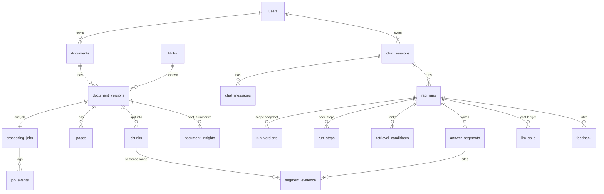
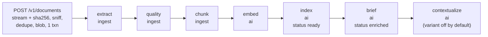
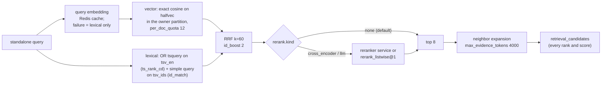
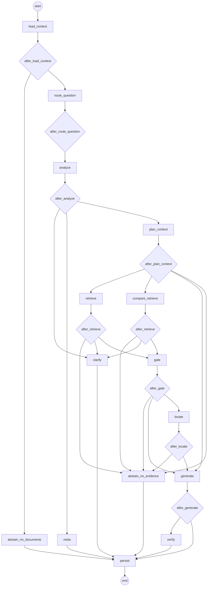

# Vault architecture

How Vault is built, why each part exists, which models do what, and how any answer can be explained. This file describes the code in this repository. Every number carries its source, and anything not measured is labelled **unmeasured**.

## How to read this

- **New to the project?** Read the TL;DR, then [section 2](#2-system-map) (the picture), [section 6](#6-chat-turn-graph) (what happens on a question) and [section 8](#8-reasoning-and-explainability) (why every answer can be checked). The rest is reference.
- **Looking for a rule?** The hard rules are in [section 1](#1-what-vault-is-and-the-principles-behind-it), each with its reason. `CLAUDE.md` repeats them as a checklist for contributors.
- **Looking for numbers?** Quality and its measurement are in `docs/evaluation.md`; speed, scale, cost and operations are in `docs/operations.md`. This file links to them rather than repeating them.
- **About to change something?** The table at the end of [section 13](#13-repo-map-how-to-run-it-and-where-to-look-when-changing-things), "If you change X, read Y", names the code, the tests and the sections to read first.

## TL;DR

1. Vault lets a user upload PDF, DOCX, TXT and Markdown files and chat with them. Every claim in an answer points to the exact stored sentence it came from.
2. Citations are **application-managed**. Each evidence sentence gets a handle (`E3.1`), the model returns handles in a strict JSON schema, and code copies `cited_text` from the stored sentence. The model never writes a quote.
3. Orchestration is code. A typed turn graph (`backend/app/chat/turn.py`) picks every edge. The model only returns typed decisions (an intent, handles, verdicts) that code validates and applies.
4. One FastAPI API process, Celery workers on three queues (`ingest`, `ai`, `maintenance`), and PostgreSQL 16 with pgvector as the single source of truth. Redis holds rebuildable state only. The reranker and observability are optional sidecars.
5. Ingestion runs `extract → quality → chunk → embed → index → brief → contextualize`. Job state lives in `processing_jobs`, with compare-and-set (CAS) claims, leases and fenced commits, so at-least-once delivery has exactly-once effects.
6. Retrieval is hybrid and exact: an OR tsquery plus `text-embedding-3-small` vectors over the owner's hash partition, fused with reciprocal rank fusion (RRF). The cross-encoder rerank and the evidence gate are **off by default** because measurements did not justify them.
7. Models are addressed by role: `fast` = `gpt-6-luna`, `balanced` = `gpt-6.1-terra`, `deep` = `gpt-6.1-sol`, `flagship` = `gpt-6-astra`. Only `backend/app/llm/routing.py` and settings name models.
8. Explanations come from reason codes and templates (`backend/app/explain/templates.py`), served at `GET /v1/runs/{id}`. The model is never asked to explain itself.
9. Quality is measured on a golden set of 316 items in 15 strata, with document-level splits, claim-level judges and clustered confidence intervals (`docs/evaluation.md`). The measured numbers are provisional because the gold set and the judges are not yet reviewed by a person.
10. Behaviour changes ship **disabled** behind switches ([section 7.3](#73-behaviour-switches)) and are enabled only when a paired evaluation on the dev split shows a gain.

## Contents

1. [What Vault is and the principles behind it](#1-what-vault-is-and-the-principles-behind-it)
2. [System map](#2-system-map)
3. [Data model](#3-data-model)
4. [Ingestion pipeline](#4-ingestion-pipeline)
5. [Retrieval](#5-retrieval)
6. [Chat turn graph](#6-chat-turn-graph)
7. [Models, prompts and behaviour switches](#7-models-prompts-and-behaviour-switches)
8. [Reasoning and explainability](#8-reasoning-and-explainability)
9. [Security and idempotency](#9-security-and-idempotency)
10. [Evaluation and quality](#10-evaluation-and-quality)
11. [Scale and operations](#11-scale-and-operations)
12. [Decisions, trade-offs and limits](#12-decisions-trade-offs-and-limits)
13. [Repo map, how to run it, and where to look when changing things](#13-repo-map-how-to-run-it-and-where-to-look-when-changing-things)

---

## 1. What Vault is and the principles behind it

The user is a professional with a growing personal collection of contracts, reports, policies and papers. Their jobs are to understand a new document fast, find a fact and verify it, compare documents, know when the documents do not answer something, and notice when something changed. "Chat with your PDF" tools lose that user's trust in predictable ways: wrong-page citations, answers built from trimmed context, silently merged stale or conflicting documents, tables and scans that fail without a signal, and confident wrong answers. Each principle below targets one of those failures.

| Principle (from `CLAUDE.md` hard rules) | Why |
|---|---|
| Every model call goes through `app.llm.gateway`. | One place for routing, retries, budgets, the cost ledger and telemetry redaction. A stray client would make cost and behaviour unattributable. |
| Citations are application-managed: the model returns handles, and code validates them and copies `cited_text` from stored sentences. An unknown handle is dropped (`CITATION_UNRESOLVED`). | A model cannot invent a quote, and the pipeline does not depend on any provider's citation feature. |
| Only `chunks.original_text` is evidence. Prefixes and summaries are never cited. | Generated text (headers, briefs) could be wrong. Only stored document text may back a claim. |
| Evidence text comes only from the glyph-mapped character stream (invariant I1). `original_text` is never re-normalized. | A cited sentence must map back to exact glyph boxes on the page for highlighting ([section 4](#4-ingestion-pipeline)). |
| Model choice is code: nodes request a role, and only `app/llm/routing.py` and settings name models. | Cost and quality trade-offs are reviewable in one table. The LLM never picks its own model. |
| The LLM never widens scope, writes SQL, or picks control flow. It returns typed decisions that code applies. | Authorization and routing stay testable. A prompt injection can at worst change a typed value that code then checks. |
| Explanations come from reason codes and templates. | A model's account of its own reasoning is not evidence. Records are. |
| Answers are never cached. | Documents, versions and scope change. A cached answer could cite a stale or deleted version. |
| The model never writes markdown tables in answers. | Citations split text into segments, which would break a table. The UI builds comparison tables from segments. |
| Delivery is at-least-once, so every consumer (task, stage, POST handler) is idempotent. | Celery, the network and clients all retry. Idempotency turns retries into no-ops ([section 9.4](#94-idempotency-at-least-once-in-effectively-once-out)). |
| Job state lives in `processing_jobs` (leases, CAS claims), not in Celery. | The broker can lose or duplicate messages. Postgres is the record, and a sweeper recovers lost work. |
| No DB connection is held across an LLM call or stream. No CPU-bound work runs on the API event loop. | Connections are the scarce resource at concurrency. A held connection across a 5 s model call starves the pool. |
| No document text, prompts or completions in logs or spans. Metric labels are bounded enums. | Privacy, and bounded metric cardinality. IDs go to traces, logs and exemplars. |
| Every repository method takes `owner_id` explicitly, and every resource has a cross-owner test that expects 404. | Tenant isolation is enforced in every query and proven per route. A 404, not a 403, avoids leaking that a resource exists. |
| Prompts are versioned files, and a change bumps the version and needs an eval run. Tuning changes are accepted only through a paired test on the dev split, and never use test-split content (`docs/evaluation.md`). | Every run records which prompt versions produced it, and changes are accepted on measured deltas, not impressions. |
| Cost discipline: live tests and evaluations run on samples with a `--max-usd` cap. | Spend is bounded per run and recorded by the run. Keys live only in the ignored `.env` file. |

Product principles that follow from those failures:

- **Honest uncertainty.** The system abstains rather than invents, shows disagreement rather than averaging it, and reports coverage states (answered, partial, not found) instead of confidence percentages, which no calibrated model could back.
- **Evidence is first-class.** Every answer segment links to immutable sentences of a specific document version.
- **Everything attributable.** Every model call, stage, candidate and decision is recorded with cost, latency and a reason.
- **Measure before adding.** Retrieval and prompt changes are enabled only with a measured delta ([section 7.3](#73-behaviour-switches)).
- **Smallest system that meets the target scale.** Built for tens of concurrent users, with a documented path to about a thousand daily users without redesign (`docs/operations.md`).
- **Answer format.** A lookup gets a one-line answer and its quote; an explanation is answer-first with cited points; a comparison is one short cited paragraph per dimension per document; an ambiguous question gets a code-written clarifying question with option chips; an abstention says what was searched and suggests a rephrasing.

Non-goals: team workspaces and roles, open-web search, document editing, cross-user sharing, guaranteed OCR, provider failover, a mobile app.

---

## 2. System map


Legend: solid arrows are calls on the default stack. Dashed arrows are optional dependencies the system survives losing: without the reranker, retrieval keeps fusion order; without `otel-lgtm`, requests are unaffected. Service names match `docker-compose.yml`. The compose file also has optional profiles that the default stack does not use (`minio` via SeaweedFS, `phoenix`, `pgexporter`, `pgbouncer`). The diagram source is `docs/img/topology.mmd`.

**Data flow.** An upload streams into the API. The API sniffs the type by magic bytes, deduplicates on `(owner_id, sha256)`, stores the blob by content hash, and writes `documents`, `document_versions` and `processing_jobs` in one transaction. It then CAS-dispatches the job, and the payload is the job id only. Workers claim the job with a lease, run one stage, and commit that stage's outputs fenced by the lease. The next stage is then dispatched. CPU-bound stages run on the `ingest` queue and I/O-bound ones on `ai`. When `index` commits, the version is `ready` and searchable. When `brief` commits, it is `enriched`. A chat message starts a turn. The API claims the session's turn lease, runs the turn graph (analysis, retrieval, generation and checks, each node opening its own short DB session), streams typed events over SSE, and writes the whole turn (run, message, segments, evidence, candidates, steps, LLM-call links) in one ledger transaction.

---

## 3. Data model

The schema is in `backend/app/db/models/*.py` with four Alembic migrations in `backend/app/db/migrations/versions/`. IDs are UUIDv7, which is time-ordered and B-tree friendly (`backend/app/core/ids.py`).



| Table | What it holds | Invariants and why |
|---|---|---|
| `users` | email, `api_key_hash` (SHA-256 of a `vk_` token), `is_admin` | Only the key hash is stored (`backend/app/core/auth.py`). |
| `blobs` | `sha256` PK, size, mime, `storage_key`, `refcount` | Content-addressed storage. A purge decrements `refcount` and deletes the blob at 0. |
| `documents` | owner, title, `current_version_id`, category, tags, `deleted_at` | Soft delete takes the document out of every scope query immediately. |
| `document_versions` | `version_no` (unique per document), sha256, status, `quality`, `chunker_version`, `embedding_model`, `ready_at`, `enriched_at`, `superseded_at`, `purged_at` | Status moves only along legal edges via CAS (`backend/app/ingestion/status.py`). |
| `pages` | per-page size, `text_chars`, `quality_score`, flags (for example `needs_ocr`) | Written by the `quality` stage. |
| `processing_jobs` | one row per version: `current_stage`, status, `attempt_count`, `max_attempts` (5), `next_attempt_at`, `lease_owner`, `lease_expires_at`, `last_dispatched_at`, error | The only record of job state. Celery messages carry the job id only. |
| `job_events` | per stage attempt: status, duration, detail | Feeds `/v1/metrics/processing` and the stage-time numbers in [section 11](#11-scale-and-operations). |
| `chunks` | hash-partitioned by `owner_id` (32 partitions), PK `(owner_id, id)`, unique `(owner_id, version_id, ordinal)`. Columns: `original_text`, `structural_prefix`, `contextual_prefix`, `embedding_text`, `sentences`, `spans`, `embedding halfvec(1536)`, `tsv_en` (generated from `embedding_text`), `tsv_ids` | **`original_text` is evidence** (an exact slice of the glyph-mapped stream). **`embedding_text` is index-only**: prefix plus optional header plus text. It feeds vectors and `tsv_en` but is never shown as evidence. `sentences` are offsets into `original_text`. `spans` map them to page character ranges for highlighting. |
| `document_insights` | `kind` (brief, summary), `params_hash`, `content`, status, model, `prompt_version` | Unique per `(version_id, kind, params_hash, prompt_version)`, so a re-run never duplicates. |
| `llm_cache` | output keyed by content hash + prompt@version + model | Paid ingestion outputs are never bought twice. Answers are never cached here. |
| `chat_sessions` | scope (`scope_document_ids`), rolling summary, resolved entities, `active_run_id`, `run_lease_expires_at` | One active turn per session through a CAS lease (`LEASE_SECONDS = 120` in `backend/app/chat/sessions.py`). |
| `chat_messages` | role, content, `response_type`, `coverage_state`, `run_id`, followups, `stale_since` | Unique `(session_id, client_message_id)`, so a retried POST returns the existing message. |
| `rag_runs` | one per turn: route, mode, `original_query`, `standalone_query`, `analysis`, `coverage`, `conflicts`, status, `reason_codes`, `degraded`, `limits`, `config` (prompt versions, models, retrieval config), token and cost totals, `latency_ms`, `ttft_ms`, `trace_id` | The evidence ledger's root. Totals are summed from linked `llm_calls`. `replay_of_run_id` exists in the schema, but no replay endpoint exists. |
| `run_versions` | the version snapshot a run was scoped to | The ledger refuses a cited or candidate chunk outside this snapshot (`backend/app/chat/ledger.py`). |
| `run_steps` | per node: `seq`, status, `duration_ms`, `decision`, `reason_code`, `error_code` | The node waterfall shown in the why view. |
| `retrieval_candidates` | per candidate: vector rank and distance, lexical rank and score, `id_match`, `rrf_score`, `rerank_score`, `selected`, `expanded_from` | Full ranking provenance, so `eval.replay` can re-rank offline for $0. |
| `answer_segments` | per segment: text, `support` (cited or none), `verification`, `verification_reason` | Unique `(run_id, ordinal)`. |
| `segment_evidence` | `(segment_id, chunk_id, sentence_start)` PK, `sentence_end`, `cited_text` | Half-open range check `sentence_start < sentence_end`. `cited_text` is copied from storage. |
| `llm_calls` | one row **per attempt**: purpose, lane, provider, role, requested `model`, `resolved_model`, `prompt_id`, `prompt_version`, tokens (input, output, cache read, cache write), `cost_usd`, latency, TTFT, status, `error_type` | The cost ledger. Daily quotas sum it (`backend/app/core/quota.py`). |
| `feedback` | per run, optionally per segment or chunk: `kind`, note, `eval_status` | One rating per (answer, segment) per user (`backend/app/feedback/service.py`). |
| `idempotency_keys` | `(owner_id, key)`, request hash, stored response | The same key with a different body gives 422 (`backend/app/api/idempotency.py`). |
| `eval_runs`, `eval_results` | eval bookkeeping | Not used by the product path. |
| `matrices`, `matrix_columns`, `matrix_cells` | schema for the Compare Matrix | **The tables exist, but no code uses them**; the comparison matrix is not built (see [section 12](#12-decisions-trade-offs-and-limits)). |

Quotas are not a table. Spend today is `sum(llm_calls.cost_usd)` since UTC midnight, cached in Redis for 30 s, against `USER_DAILY_USD` (default $1.00; admins are unlimited). Ingestion is never blocked by the quota: the brief stage defers instead (`backend/app/core/quota.py`).

---

## 4. Ingestion pipeline



`STAGE_ORDER` is defined in `backend/app/ingestion/runner.py`, and the stage-to-task mapping (and therefore the queue) is `STAGE_TASKS` in `backend/app/ingestion/jobs.py`. The version status machine: `uploaded → processing → ready → enriched`. From `processing`, a version can also end in `needs_ocr`, `unsupported` or `failed`. A ready or enriched version becomes `superseded` when a newer version of the same document reaches `ready`. Diagram source: `docs/img/ingestion.mmd`.

| Stage | What it does | What it guarantees |
|---|---|---|
| upload (`backend/app/documents/upload.py`, `sniff.py`, `service.py`) | Streams multipart to a temp file in about 64 KB pieces, computing sha256. Aborts with 413 above `MAX_UPLOAD_BYTES` (25 MB). Sniffs magic bytes and never trusts the extension. Dedupes on `(owner_id, sha256)`. Then one transaction for document, version and job, and a CAS dispatch. | Re-uploading the same bytes returns the existing version. Nothing larger than one piece is held in memory. |
| `extract` (`backend/app/ingestion/extract/`) | PDF via pdfplumber in a subprocess with a wall-clock timeout (`PARSE_TIMEOUT_S` 120) and a memory cap (`PARSE_MEMORY_MB`, Linux only). DOCX via python-docx after a zip size and ratio check (`docx.py`: 100 MB uncompressed, ratio 100). TXT and MD via `text.py`. PDFs over `MAX_PAGES` (600) end `unsupported`. The output is persisted to the object store, so retries never re-parse. | Invariant I1: every character of the page text maps to a glyph or is a synthetic space or newline. |
| `quality` (`quality.py`) | `pages` rows with `quality_score` and flags: text density, multi-column signal, tables, replacement characters. | Scanned pages are flagged `needs_ocr`. If most pages are flagged, the version is `needs_ocr`. OCR is not built. |
| `chunk` (`chunk.py`, `chunk_rules.py`, `sentences.py`, `identifiers.py`, `index_text.py`) | Structure-aware chunks, a rule-based sentence splitter, `spans` back to page character ranges, identifier tokens for `tsv_ids`, and the `structural_prefix`. Writes the per-version layout file with glyph boxes. | `original_text` is an exact slice of page text (I1). Chunks from two chunker versions never coexist in one version. |
| `embed` (`embed_index.py`) | `text-embedding-3-small` over `embedding_text`, with up to `EMBED_CONCURRENCY` (4) batches in flight. Cached by `content_hash` and model. | Unchanged chunks on a re-upload cost nothing. |
| `index` (`embed_index.py`) | Writes `tsv_ids`, sets `ready`, supersedes the previous version, and marks earlier answers scoped to an older version as stale (`backend/app/insights/staleness.py`, `WHERE stale_since IS NULL`). | The version is searchable, and chat unlocks here. |
| `brief` (`backend/app/insights/stage.py`) | `brief_extract@3` (one call if the evidence fits `BRIEF_MAX_EVIDENCE_TOKENS` = 12,000, else a map over section groups with `BRIEF_CONCURRENCY` = 3) followed by `brief_merge@2`. Capped at `BRIEF_MAX_USD` ($0.05) per document. Every fact is quote-verified in code (`backend/app/insights/verify.py`). `BRIEF_ENABLED=false` skips the stage. | A failed brief leaves the version at `ready`, so chat never waits on it. Over quota, the stage defers. |
| `contextualize` (`backend/app/ingestion/contextualize.py`) | Adds an index-only header to `embedding_text` and re-embeds only the chunks whose text changed. Variants: `CONTEXTUALIZE_VARIANT` / `INDEX_CONTEXT` set to `deterministic` (a header built by code) or `llm` (`chunk_context@1`). | Never touches `original_text` or `sentences`. Never fails the pipeline. Off by default (`none`/`off`). |

**Why pdfplumber and a glyph-mapped stream.** Highlighting the exact cited sentence needs every evidence character tied to a glyph box. pdfplumber exposes character objects with coordinates under an MIT license, while PyMuPDF is AGPL and is avoided. The extraction configuration `use_text_flow=True, x_tolerance_ratio=0.15` was chosen by a sweep: 99 of 100 expert gold quotes located versus 86 of 100 with the defaults, and two-column papers 22 of 23 versus 9 of 23 (`docs/evaluation.md` section 4). A profiling fix replaced pdfplumber's quadratic `dedupe_chars`, taking the AMD 10-K from 37 s and 720 MB to 11.3 s and 198 MB (`docs/operations.md` section 2.1).

**The geometry chain** turns a PDF into evidence that can be highlighted. Its invariants:

1. **I1, one character stream.** Page text is built only from glyph characters, plus synthetic spaces and newlines that are marked as such. Every evidence character therefore maps to a box or to a known separator, and nothing downstream rewrites the text.
2. **Display space.** Coordinates are normalized to the rendered CropBox and `/Rotate` is mapped through, so a box lands where the page renders. Pages whose content is already counter-rotated (landscape tables) choose the extraction frame from the dominant glyph direction, then map boxes back to display space.
3. **Reading order** is repaired by a column-jump detector (`backend/app/ingestion/extract/reading_order.py`), and table cells are built from glyph-mapped words (`pdf_tables.py`).
4. **Offsets, not copies.** A chunk stores `original_text`, sentence offsets into it, and `spans` mapping those to page character ranges. The per-version layout file holds the glyph boxes, so the UI computes a highlight from offsets (`GET /v1/chunks/{id}`, `GET /v1/versions/{id}/pages/{n}/layout`, `frontend/src/source/highlight.ts`) and offsets cannot drift from the text.
5. **Honest fallback.** When a highlight cannot be computed (an empty or invalid range, or no layout file) the viewer shows the plain cited text instead of guessing a box.

**Chunker versions** (`CHUNKER_VERSION`, default `chunker@1`):

| Version | Rules | Status |
|---|---|---|
| `chunker@1` (`chunk.py`) | Group by section, pack to about 400 tokens (800 max) with about 15% whole-sentence overlap. Tables are standalone chunks with the header row repeated. A table row is one sentence. | Default. |
| `chunker@2` (`chunk_rules.py`) | Cut at headings, tables and captions first, then pack (target 350, max 600). Tables stay whole up to 1,200 tokens. Header rows are repeated in index text only. Captions get their own chunk. | Switch `CHUNKER_VERSION`, off. Switching needs a re-ingest. |
| `chunker@2-overlap25` | `chunker@2` plus the last 25% of the previous same-section chunk, in index text only. | Switch, off. |

**Idempotency and leases** (`backend/app/ingestion/jobs.py`, `runner.py`, `sweeper.py`):
- **Dispatch** is a CAS `UPDATE processing_jobs ... RETURNING`. Only the winner enqueues.
- **Claim**: a worker takes a lease (`LEASE_S = 300`) and heartbeats every 60 s (`HEARTBEAT_S`). If there is no row, another worker holds a live lease and the task exits, so a duplicate delivery collapses.
- **Fenced commit**: one transaction replaces the stage's outputs, advances `current_stage` and appends a `job_events` row, but only if the worker still owns the lease. A worker that lost its lease commits nothing.
- **Failure**: permanent errors (corrupt, encrypted, unsupported) are terminal at once. Retryable errors back off with jitter for up to 5 attempts, then the job is `dead` and the version `failed` with a retry action.
- **Sweeper** (beat): re-dispatches lost dispatches, expired leases and due retries. This is eventual recovery, not a transactional outbox; an outbox is the upgrade path.
- **Fairness**: no per-owner cap on concurrently processing versions is implemented. Behaviour under load is **unmeasured** (`docs/operations.md`).

**Deletion** (`backend/app/documents/delete.py`): a soft delete excludes the document from retrieval immediately. A purge task removes chunks, insights and layouts, decrements the blob refcount, and sets `purged_at` on the version, which is kept for the ledger. Stored answers keep their text, but deleted evidence returns `deleted: true` with `cited_text: null`.

---

## 5. Retrieval

`backend/app/retrieval/retrieve.py` is the facade: a scope and a query go in, and ranked candidates with full provenance come out. The configuration is a versioned YAML file in `backend/config/` (strict loader `backend/app/retrieval/config.py`). The default is `RETRIEVAL_CONFIG=retrieval@5`.



| Step | Detail (from `backend/config/retrieval@5.yaml` and module docstrings) |
|---|---|
| Scope (`scope.py`) | The latest `ready`/`enriched` version of each document in the session scope, owned by the caller and not deleted. The analysis may narrow it but never widen it. Every SQL statement filters `owner_id` and `version_id = ANY(...)`. |
| Vector (`vector.py`) | Exact, brute-force cosine search over one owner's chunks, `k_vec` 40. `per_doc_quota` 12 caps the hits per document in a cross-document scope; a one-document scope gets the full `k_vec` list (`single_doc_full_k`). Hash partitioning prunes the query to 1 of 32 partitions. There is no ANN index. HNSW is the escape hatch above about 100,000 chunks in one scope, designed but **not built**. |
| Lexical (`lexical.py`, `numbers.py`) | An **OR** tsquery of the query's English lexemes, ranked by `ts_rank_cd`, `k_lex` 40, plus an identifier query on `tsv_ids` for clause numbers, IDs, amounts and dates. `retrieval@2-lexical2` adds number and unit variants. |
| Fusion (`fusion.py`) | Reciprocal rank fusion, `rrf_k` 60, identifier matches weighted 2. |
| Rerank (`rerank.py`, `listwise.py`, `windows.py`) | `kind: llm`: one `rerank_listwise@1` call on `fast` orders the top 50 fused candidates, each shown as a query-focused window of at most 180 words with dot-leader runs collapsed (`collapse_leaders`; the reranker's copy only, never evidence), and the top 8 are kept. The alternatives are `retrieval@2` (`kind: none`, fusion order) and `retrieval@2-rerank` (MiniLM cross-encoder in the `reranker` service). On a reranker timeout or failure, the turn keeps fusion order and records `degraded=no_rerank`. |
| Expansion (`expand.py`) | Adds adjacent same-section chunks within a 4,000-token evidence budget, for answers split across chunks. |
| Speculative retrieval (`backend/app/chat/speculative.py`) | Retrieval of the raw question starts while `analyze` runs. It is reused only when the analysis leaves the query and scope unchanged, otherwise it is cancelled. This saves latency and never changes the result. |

**Decisions made from measurements.** The evidence for each is in `docs/evaluation.md` section 4.

| Decision | Why |
|---|---|
| The lexical leg uses an OR query, not AND. | AND starved the lexical leg: lexical-only recall@8 rose from 0.150 to 0.633. |
| **Reranker off** (`rerank.kind: none`). | The rule was fixed before measuring: keep it only if it is better, or not different with MRR@40 up by 0.03, and it adds at most 400 ms at p50. There is no detectable quality difference and it adds 495 ms at p50. |
| **Evidence gate off** (`gate.enabled: false`). | The calibrated floor refused 3 of 44 answerable train items. The floor value 0.3803 stays in the file for use with scored abstention. |
| Number-aware lexical matching off. | No detectable difference on the retrieval set, which has few numeric queries. |
| Whole-document mode not automatic (`FULL_CONTEXT_AUTO=false`). | No gain at about twice the cost per turn. |

The largest known quality lever is ranking: on the train split, 12 of 27 real failures retrieved the gold chunk but did not keep it in the evidence set (`docs/evaluation.md` section 3).

---

## 6. Chat turn graph

The graph is small, typed and dependency-free (no LangChain), in `backend/app/chat/graph.py`. The nodes are in `backend/app/chat/nodes/` and the routers in `backend/app/chat/turn.py`. The runner wraps each node in an OTel span `vault.node.<name>`, applies the turn deadline, and records a `run_steps` row. A node that raises or times out jumps to `persist` (`on_error`), which writes an error response, so a turn never ends stuck. At most `MAX_NODE_RUNS` = 12 node executions run per turn.

This diagram is **generated from code**. `scripts/gen_turn_diagram.py` writes `docs/img/chat_turn.mmd` from `GRAPH.describe()`, and `backend/tests/unit/docs/test_diagrams.py` fails when the committed file is stale. The copy below matches it:



Legend: rectangles are nodes (async functions over the typed `TurnState`), and diamonds are routers, named after the code function that returns the next node.

| Node | What it does | Model call |
|---|---|---|
| `load_context` | Session, scope, memory and document titles in one short DB session. An empty scope goes to `abstain_no_documents`. | none |
| `route_question` | Fast-path rules (`backend/app/chat/routing_rules.py`): a self-contained question with no pronoun, comparison or meta cue skips the analysis call. Any doubt means analyze. | none |
| `analyze` | `analyze_query@4` (`fast`). Returns the intent, standalone query, dimensions, an optional document narrowing, an optional `meta_op` and a clarification hint. Code drops unknown or foreign document refs, caps free text, and on any failure falls back to the raw question (`ANALYZE_FALLBACK`). The query embedding and speculative retrieval run at the same time. | 1, or 0 on the fast path |
| `plan_context` | Chooses RAG or full context (`backend/app/chat/full_context.py`). Full context loads every chunk in order if the prompt fits `FULL_CONTEXT_MAX_TOKENS` (50,000) plus 4,000. Otherwise it falls back to RAG (`FULL_CONTEXT_TOO_LARGE`). | none |
| `retrieve` / `compare_retrieve` | Hybrid retrieval, or for a compare intent over 2 to 5 documents, per-document retrieval with `max(3, 8 // n)` passages each, so one document cannot crowd out the others (`backend/app/chat/compare.py`). | embeddings only |
| `gate` | The no-LLM evidence floor on `top_score`, off in `retrieval@5`. With `CHAT_ABSTAIN_SCORED` and a fitted `backend/config/abstain@1.yaml`, a logistic combiner decides instead (`backend/app/chat/abstain.py`). | none |
| `locate` | Behind `CHAT_LOCATE`. A bounded in-document loop for one long document (at least 150 chunks or 60 pages) when the first pass is low-confidence. `locate_step@1` returns `search`/`find`/`open`/`done`, and code validates and runs each step. | up to the step cap |
| `generate` | Builds the evidence set with handles and calls `answer_rag@12` (or `answer_compare@3` for compare), streaming. Resolves citations in code, validates conflicts and follow-ups, and runs the calc and coverage checks when their flags are on. | 1 |
| `verify` | The support check (`support_check@1`, `fast`) over cited segments. Version 1 is advisory: it annotates verdicts and adds reason codes. Version 2 (`CHAT_SUPPORT_VERSION=2`) also prunes, removes unsupported segments, and regenerates once. | 1 |
| `clarify` | A code-written question with option chips (`backend/app/chat/clarify.py`, behind `CHAT_CLARIFY`). The model never decides to ask and never writes the options. | none |
| `meta` | Questions about the library ("how many documents...") answered by one allowlisted, parameterized, owner-scoped query per op (`backend/app/chat/meta.py`). The model never writes SQL and never sees rows. | none |
| `abstain_no_documents`, `abstain_no_evidence` | Template responses (`backend/app/chat/nodes/terminal.py`). | none |
| `persist` | One transaction: finishes the run, writes the message, segments, evidence, run versions, steps, candidates and LLM-call links, and releases the session lease. Idempotent: a run that already has an assistant message returns it. | none |

**Routes and modes.** Route limits (`backend/app/chat/harness.py`, `ROUTE_LIMITS`): `qa` 4 calls / 30 s, `compare` 4 / 45 s, `summarize` 2 / 60 s, `meta`, `chitchat` and `clarify` 1 / 10 s. Every gateway call charges this budget. Mode is `rag` or `full_context`. Generation escalates from `balanced` to `deep` only on typed signals (`generate:compare`, `generate:conflict` in the routing table), never on the model's self-reported confidence.

**Streaming (SSE).** `backend/app/chat/events.py` defines a pydantic union discriminated on `type`, where every event carries `run_id`: `run.started`, `status` (stages `analyzing`, `retrieving`, `checking_evidence`, `writing`, `verifying`, `saving`), `segment` (text plus resolved evidence with `cited_text`, `support`), `verification`, `followups`, `clarify`, `done` (usage), and `error`. The schema is served at `GET /v1/chat/events/schema`. `backend/app/chat/segments_reader.py` parses the strict JSON incrementally and yields each segment as soon as its object closes, so citations are validated before they are shown. The turn runs as its own task: a client disconnect closes only the generator, and the turn still persists (`backend/app/chat/stream.py`). A reconnecting client polls `GET /v1/runs/{id}`. Without `Accept: text/event-stream`, the POST blocks and returns JSON. TTFT is recorded per run (`rag_runs.ttft_ms`).

**Stale answers.** When a version reaches `ready`, `backend/app/insights/staleness.py` sets `chat_messages.stale_since` on assistant messages whose runs used an earlier version of the document (`run_versions`), in the same transaction, owner-scoped and idempotent. The UI shows the `STALE_ANSWER` line from `backend/app/explain/templates.py` with a re-ask.

**Memory** (`backend/app/chat/memory.py`): the newest whole turns within a token budget, plus the session's `rolling_summary` and `resolved_entities` when present. No code writes the rolling summary yet (the `memory_compact` route has no caller), so in practice memory is the turn window. There is no cross-session memory and no semantic answer cache.

**Abandoned turns.** `backend/app/chat/reaper.py` (beat) finishes runs whose turn died as `failed`, through the same idempotent `persist_turn`.

---

## 7. Models, prompts and behaviour switches

### 7.1 Roles and routing

Nodes ask for a role. Settings map roles to models (`backend/app/core/settings.py`: `MODEL_FAST`, `MODEL_BALANCED`, `MODEL_DEEP`, `MODEL_FLAGSHIP`), and `ModelRouter.resolve(node, route, mode)` in `backend/app/llm/routing.py` returns role, model and effort. The router validates every route against `EFFORT_SUPPORT` at startup (`gpt-6.1-sol` rejects effort `none`), so a bad `MODEL_ROUTES` override fails boot and names the node. Prices are $/MTok for input · cached input · output, read from the OpenAI price list on 2026-11-13 and overridable through `LLM_PRICES`.

| Role | Model | Price | Default routes (`DEFAULT_ROUTES`) and effort | Why this role |
|---|---|---|---|---|
| `fast` | `gpt-6-luna` | 0.10 · 0.01 · 0.50 | `analyze_query` none, `contextualize` none. The table also has `followups`, `memory_compact` and `tag_category` rows, but nothing calls them: follow-ups come from the answer schema at no extra call. Prompts with `role: fast`: `support_check`, `brief_merge`, `locate_step`, `rerank_listwise`. | A tiny structured output on the critical path. Observed 1.6 to 2.3 s on a 320-token prompt. Tolerant of small errors that code checks. |
| `balanced` | `gpt-6.1-terra` | 1.00 · 0.05 · 5.00 | `generate` none (RAG), `generate::full_context` low, `brief_extract` low, `summary` low. The `evidence_gate` and `matrix_cell` rows exist but have no caller. | Writing quality at a fifth of `deep`'s output price. The cached document prefix reads at $0.05/MTok in full-context mode. |
| `deep` | `gpt-6.1-sol` | 2.00 · 0.10 · 10.00 | `generate:compare` low, `generate:conflict` low, `eval_judge` low. | The hardest reasoning on a small share of turns. A judge should sit at or above the generator's tier (`eval/judge.py` `check_tiers`). |
| `flagship` | `gpt-6-astra` | 10.00 · 1.00 · 50.00 | `eval_audit_gold@1` and the judge-calibration subset only. | Too expensive for runtime. Used where an independent, stronger read matters (the gold audit). |

Other models and services:

| Purpose | Model | Notes |
|---|---|---|
| Embeddings | `text-embedding-3-small`, 1536 dims (`EMBEDDING_MODEL`, `EMBEDDING_DIM`) | Stored as `halfvec(1536)`. $0.02/MTok. Per-document embedding cost is **unmeasured** (`docs/operations.md` section 4). |
| Rerank (optional) | `Xenova/ms-marco-MiniLM-L-6-v2` via fastembed in `reranker/` | Apache-licensed, so there is no non-commercial model. Container p50 350.8 ms at 20 passages (`docs/operations.md` section 2.3). Off by default. |
| Judges | `eval_judge_*` prompts on `deep` | Same vendor as the generator. See [section 10](#10-evaluation-and-quality) for the bias controls. |

**Fallback.** After retries on a retryable error, the gateway makes one attempt on the next role up (`FALLBACK_ROLE`: fast to balanced, balanced to deep) and records `DEGRADED_MODEL_FALLBACK`. There is no cross-vendor failover, and the Anthropic adapter is dormant.

**Gateway contract** (`backend/app/llm/gateway.py`): resolve route, charge the turn budget, one OTel span per attempt (IDs and counters only), provider call with typed errors (`backend/app/llm/errors.py`), retry with jitter honouring `retry-after`, one `llm_calls` row per attempt in its own short session, stop-reason checks and schema validation, then the fallback. All calls use the OpenAI Responses API with strict JSON schema. RAG calls use explicit prompt caching with no breakpoint, because the default implicit mode billed every prompt as a 1.25× cache write (measured with a probe: 4,513 cache-write tokens became 0).

### 7.2 Prompts

All prompts live in `backend/prompts/<id>@<version>.md`, with front-matter for `role`, `purpose`, `output` (schema, segments or text), `effort` and `max_tokens`, loaded by `backend/app/llm/prompts.py`. The version is part of the file name, a change to a prompt is a new version, and every run records the versions it used in `rag_runs.config.prompts`. The table lists the versions that code paths select; other versions of the same ids stay in the directory so that recorded runs remain reproducible.

| Prompt | Role | Purpose | Selected when |
|---|---|---|---|
| `analyze_query@4` | fast | Intent, standalone query, dimensions, optional document narrowing, optional meta operation, clarification hint | Default (`backend/app/chat/nodes/analyze.py`) |
| `analyze_query@3` | fast | The same job in a shorter prompt (about 25% fewer tokens, question last, 500 max tokens) | Switch `CHAT_ANALYZE_VERSION=3` |
| `answer_rag@12` | balanced | Segments with evidence handles, conflicts and follow-ups; answers every part the question asks, keeps qualifiers and every cited detail, names a document that has no such statement and gives what it does say on the point, stays within the version or document the question names (latest version for current-terms questions), and states no label, superlative, unit, count or figure the cited sentences do not contain | Default (`CHAT_ANSWER_VERSION=12`, `backend/app/chat/nodes/generate.py`) |
| `answer_rag@7` | balanced | The completeness-first rules without the detail rules; its example sentence repeats an evaluation item's wording, so `answer_rag@11` is the same prompt with a neutral example | `CHAT_ANSWER_VERSION=7` or `11` |
| `answer_rag@8` | balanced | `answer_rag@7` plus one rule: when the evidence states what the question asks under its own period label (the question says FY2023, the text says fiscal 2022), the model states the label difference in an uncited segment and answers under the evidence's label instead of abstaining | Switch `CHAT_ANSWER_VERSION=8` |
| `answer_rag@3` | balanced | The short-answer wording ("as short as the question allows"); the plan and calc prompts below build on it | `CHAT_ANSWER_VERSION=3` |
| `answer_rag@4` | balanced | `answer_rag@3` plus a `plan` of required elements; code decides coverage | Switch `CHAT_PLAN_FIRST` |
| `answer_rag@5` | balanced | `answer_rag@4` plus typed calculation segments; code does the arithmetic | Switch `CHAT_CALC` |
| `answer_compare@3` | balanced, routed to `deep` | Per-document comparison answer | Default for compare turns |
| `answer_compare@2` | balanced, routed to `deep` | Comparison with a per-document coverage rule and one repair | Switch `CHAT_COMPARE_QUOTA` |
| `support_check@1` | fast | Per-segment support verdict; advisory | Default |
| `support_check@2` | fast | Verdict plus the minimal handles needed; code repairs the answer | Switch `CHAT_SUPPORT_VERSION=2` |
| `voice@1` | balanced | Tone-only fragment appended to answer prompts | Switch `CHAT_VOICE` |
| `locate_step@1` | fast | Typed next move of the locate loop | Switch `CHAT_LOCATE` |
| `rerank_listwise@1` | fast | LLM listwise rerank | Retrieval config `retrieval@2-llm` only |
| `brief_extract@3` | balanced | Document brief: summary, facts with handles, tags, category (1,800 max tokens) | Default (`backend/app/insights/stage.py`) |
| `brief_merge@2` | fast | Merge of map-step briefs, with tone | Default |
| `summary_custom@1` | balanced | Custom summaries (`POST /v1/documents/{id}/summaries`) | Default (`backend/app/insights/summaries.py`) |
| `chunk_context@1` | fast | Index-only chunk header | `INDEX_CONTEXT=llm` or `CONTEXTUALIZE_VARIANT=llm` |
| `eval_judge_claims@4`, `eval_judge_support@3`, `eval_judge_abstain@1` | deep | Claim-level answer, support and abstention judges | Evaluation default |
| `eval_judge_faithfulness@1`, `eval_judge_citation@1`, `eval_judge_completeness@1`, `eval_judge_rubric@1` | deep | Binary judges of the legacy golden set | Legacy evaluation |
| `eval_migrate_claims@1`, `eval_draft_table_q@1`, `eval_audit_gold@1` | balanced, balanced, flagship | Dataset construction: claim migration, table-question drafting, independent gold audit | Dataset build scripts |
| `_example@1` | fast | Template for a new prompt | Not used |

What has been measured about prompts is in `docs/evaluation.md`: `support_check@1` agrees with the faithfulness judge (agreement 0.92, kappa 0.83, n = 37), and brief facts are verified by code (56 of 58 on 3 sample documents). The prompts selected by a switch are evaluated by the acceptance rule in section 7.3.

### 7.3 Behaviour switches

Switches live in `backend/app/core/settings.py` and are mirrored in `.env.example`. A behaviour change ships disabled and is enabled only when a paired evaluation on the dev split shows it helps. The rule is in `docs/evaluation.md` section 1.5, the tooling is `make eval-gate`, and measurements are in `docs/evaluation.md`. Accepting a switch is a one-line default change, and a rejected switch is deleted.

| Switch (env) | Default | What it does | How it is decided |
|---|---|---|---|
| `CHAT_PLAN_FIRST` | `false` | `answer_rag@4`: a coverage plan, with `ELEMENT_NOT_FOUND` segments for required elements the evidence lacks | Paired dev evaluation |
| `CHAT_CALC` | `false` | `answer_rag@5`: typed calculations computed in code with `Decimal` (`backend/app/chat/calc.py`) | Paired dev evaluation on the numeric stratum |
| `CHAT_COMPARE_QUOTA` | `false` | `answer_compare@2` and a per-document coverage repair | Paired dev evaluation on compare and conflict strata |
| `CHAT_SCOPE_FLOOR` | `false` | Plain qa turns over 2-5 scoped documents: a document with fewer than two selected chunks is topped up from its own best candidates | Paired dev evaluation on aggregation and compare strata |
| `CHAT_NAMED_DOCS` | `false` | A question that names 2-5 scoped documents (matched in code against titles and opening text, no model call) also retrieves inside each named document and tops each up to `CHAT_NAMED_DOCS_K` (3) chunks in the global selection | Paired dev evaluation on compare, aggregation and conflict strata |
| `CHAT_SUPPORT_VERSION` | `1` | `2` selects `support_check@2`: prune, remove unsupported segments and regenerate once | Paired dev evaluation |
| `CHAT_ANSWER_VERSION` | `12` | `12` completeness-first answers with detail discipline (`10` is the same prompt with example names taken from the evaluation set); `7` without the detail rules (`11` is `7` with a neutral example); `9` is `10` without the derived-count and keep-every-detail rules; `3` the short-answer wording (`6` is `7` without the scope rule); `8` is `7` plus answering under the evidence's own period label instead of abstaining | Paired runs against `7` with `retrieval@5`: support_rate +4.5 (train) and +2.7 (dev), answer_pass -0.8 and +1.7 (no detectable difference), injection 0, citation integrity 1.00, must_not_contain 22/22 |
| `CHAT_ANALYZE_VERSION` | `4` | `3` selects the shorter `analyze_query@3`; `2` is `4` with example document names taken from the evaluation set | Paired dev evaluation plus a live time-to-first-token measurement |
| `CHAT_ABSTAIN_SCORED` | `false` | Logistic abstention (`backend/config/abstain@1.yaml`, `fitted: false`) in place of the floor gate | Calibration on the train split, then a paired dev evaluation |
| `CHAT_LOCATE` (+ `CHAT_LOCATE_MIN_CHUNKS` 150, `CHAT_LOCATE_MIN_PAGES` 60) | `false` | Locate loop for long single documents | Paired dev evaluation on long-filing strata |
| `CHAT_VOICE` | `false` | Appends `voice@1` to answer prompts | Paired dev evaluation (faithfulness non-inferior) and review of `docs/voice.md` |
| `CHAT_CLARIFY` | `false` | Code-decided clarification chips | Review of the interaction in the UI |
| `FULL_CONTEXT_AUTO` (+ `FULL_CONTEXT_MAX_DOCS` 3, `FULL_CONTEXT_MAX_TOKENS` 50,000) | `false` | Automatic whole-document mode | Measured: no gain at twice the cost, so it stays off (`docs/evaluation.md` section 4) |
| `CHUNKER_VERSION` | `chunker@1` | `chunker@2`, `chunker@2-overlap25` | Retrieval-only paired evaluation after a re-ingest |
| `INDEX_CONTEXT` | `none` | `deterministic` or `llm` index-only headers | Retrieval-only paired evaluation after a re-ingest |
| `CONTEXTUALIZE_VARIANT` (+ `CONTEXTUALIZE_MAX_USD` $0.02) | `off` | Alias for the same stage as `INDEX_CONTEXT`; `INDEX_CONTEXT` wins when both are set | As `INDEX_CONTEXT` |
| `RETRIEVAL_CONFIG` | `retrieval@5` | `retrieval@4` (no leader collapse), `retrieval@3`, `retrieval@2` (no reranker), `retrieval@2-rerank`, `-llm`, `-lexical2`, `-norerank`, `-fullk`, `retrieval@1` | Retrieval-only paired evaluation (section 5) |

Operational settings that are not behaviour experiments:

| Setting | Default | Meaning |
|---|---|---|
| `CHAT_FAST_PATH` | `true` | Skip `analyze_query` for self-contained questions (a kill switch) |
| `CHAT_SPECULATIVE_RETRIEVAL` | `true` | Retrieve the raw question while analysis runs (latency only) |
| `BRIEF_ENABLED` (+ `BRIEF_MAX_USD`, `BRIEF_CONCURRENCY`, `BRIEF_MAX_EVIDENCE_TOKENS`) | `true` | The brief stage; evaluation uploads turn it off |
| `LLM_PROVIDER` | `openai` | `fake` is a scripted model for UI tests and is refused in production |
| `MODEL_ROUTES`, `MODEL_*`, `LLM_PRICES` | empty / role defaults | Routing and price overrides |

---

## 8. Reasoning and explainability

**Rule:** every user-facing explanation is rendered by deterministic templates from what the run recorded. No model is asked why it answered (`backend/app/explain/`).

### 8.1 The pieces

| Piece | Where | What it guarantees |
|---|---|---|
| Evidence handles | `backend/app/chat/evidence.py` | Each evidence chunk gets `E<k>`, and each sentence `E<k>.<i>`. In RAG mode the schema makes every `evidence` item an enum of this request's handles (up to `MAX_ENUM_HANDLES` = 1000), so the decoder cannot emit an unknown one. A citation spike measured 0 invalid handles over 12 items (`docs/evaluation.md` section 4). |
| Citation resolution | `backend/app/chat/citations.py` | Handles are looked up in the request manifest, adjacent sentences merge into a half-open range, and `cited_text` is cut from stored `original_text`. Unknown handles are dropped with `CITATION_UNRESOLVED` and counted in `vault.citations.unresolved`. A segment with no valid handle is kept as `support=none` and shown uncited. |
| Ledger check | `backend/app/chat/ledger.py` | The transaction aborts if a cited or candidate chunk is not the owner's or is outside the run's version snapshot. |
| Per-segment verdicts | `backend/app/chat/support_check.py` → `answer_segments.verification` | `supported` / `partial` / `unsupported` / `unchecked`. The checker sees each segment with only its own `cited_text`. Failures yield `unchecked` plus `SUPPORT_CHECK_FAILED`, and the answer is never blocked. |
| Conflicts | `backend/app/chat/conflicts.py` → `rag_runs.conflicts` | The model flags `{topic, handles_a, handles_b}`. Code keeps a conflict only if both sides resolve and touch at least 2 distinct chunks. The UI shows `frontend/src/chat/ConflictCallout.tsx` with both quotes. |
| Abstain and partial | `backend/app/explain/templates.py` | Code-written texts (`ABSTAIN_TEXT_*`, `NOT_FOUND_ELEMENT`, `PARTIAL_ANSWER_TEXT`, `SIDE_NOT_FOUND`). A compare side with no evidence gets a code-appended "nothing relevant was found" sentence (`COMPARE_SIDE_NOT_FOUND`). |
| Reason codes | `rag_runs.reason_codes`, `run_steps.reason_code` | `REASON_TEMPLATES` maps 47 codes to user lines, and an empty template means operator-only (for example `FAST_PATH`). A unit test greps every code constant in `app/chat`, `app/retrieval` and `app/llm` and requires a template (`backend/tests/unit/explain/test_templates.py`). |
| Degradations | `rag_runs.degraded` | `no_rerank`, `lexical_only` map to `DEGRADED_TEMPLATES`. |
| Run record | `rag_runs` | `config` holds the prompt versions, role-to-model map and retrieval config. `analysis` holds intent and dimensions, plus `abstain` features, `locate` (actions, argument digests, counts), `clarify` options and `supersedes` when present. Also tokens, cost, latency, TTFT and `trace_id`. |
| Why view | `GET /v1/runs/{id}` (`backend/app/api/runs.py`, `backend/app/explain/views.py`) and `frontend/src/chat/WhyPanel.tsx` | Status, mode, route, reason codes, template-rendered `explanation` lines, sources (document, version, pages, passages used), node steps with durations, usage (calls, tokens, cost) and the stored message. It exposes no prompt ids, model names or trace ids. Another owner's run is 404. |
| Traces and logs | `backend/app/observability/otel.py`, `backend/app/core/logging.py` | Spans `vault.node.*` and per-attempt gateway spans, JSON logs with IDs. No document text (`CLAUDE.md`). |

### 8.2 Worked example: one answer's explanation path

This is an illustrative turn, not a recorded run. The field names and template strings are the real ones. A user asks: "What is the notice period for termination?" over one ready document, "Services Agreement" (version 2).

1. `route_question` finds no pronoun or comparison cue, so `analyze` records a skipped step and the reason code `FAST_PATH` (operator-only, empty template).
2. `retrieve` stores 40 to 80 `retrieval_candidates` rows with `vector_rank`, `lexical_rank`, `rrf_score` and `selected`. The listwise reranker orders the top 50 by fusion, and its top 8 plus neighbours become evidence chunks `E1`…`E9`.
3. `generate` sends lines like `E3.1 Either party may terminate on thirty days written notice.` and receives `{"status":"answer","segments":[{"text":"Either party can end the agreement with 30 days' written notice.","evidence":["E3.1"]}], ...}`.
4. `citations.resolve` maps `E3.1` through the manifest to `(chunk_id, sentence 1)` and writes `segment_evidence(chunk_id, sentence_start=1, sentence_end=2, cited_text=<copied from chunks.original_text>)`. `answer_segments.support = 'cited'`.
5. `verify` runs `support_check@1` on that segment and its `cited_text` only, and writes `answer_segments.verification = 'supported'`.
6. `persist` writes `rag_runs` with `route='qa'`, `mode='rag'`, `reason_codes=['FAST_PATH']`, `config.prompts=['analyze_query@4','answer_rag@12','support_check@1']`, `config.retrieval='retrieval@5'`, plus `llm_calls_used`, `cost_usd`, `latency_ms` and `ttft_ms`.
7. `GET /v1/runs/{id}` computes `sources` from `segment_evidence` joined to chunks, versions and documents, giving one document with `chunks_used: 1` and its pages. `_explain` renders `ANSWERED_ONE_DOC`: **"Answered from 1 passage in 'Services Agreement' v2."** If the check had returned `unsupported`, the view would add **"One sentence is not backed up by its citation, so read it with care."** (`UNSUPPORTED_ONE`). If the reranker had been configured and timed out, it would add **"Passage ranking was not available, so passages are shown in search order."**
8. In the UI, hovering the citation shows `cited_text`. Clicking it opens the source viewer, which turns the sentence offsets, then `spans`, then the page character range, then glyph boxes from the version's layout file (`GET /v1/versions/{id}/pages/{page}/layout`) into a highlight.
9. When version 3 of the document reaches `ready`, `stale_since` is set on this message and the UI shows **"A newer version of this document was added after this answer. Ask again to see if anything changed."**

### 8.3 Voice

`docs/voice.md` sets how Vault talks: calm, warm, direct, answer first, never blaming the user, no filler, no exclamation marks. Numbers, names and dates stay exact, and there is always a gentle next step when Vault cannot answer. **Warmth never loosens grounding**: the voice changes wording only, never citations or abstention. Code-written messages in `backend/app/explain/templates.py` follow it always (tested by `backend/tests/unit/explain/test_voice_templates.py`). Model-written answers follow it only with `CHAT_VOICE` (`voice@1`, appended after the answer prompt so its citation rules and schema are untouched, tested by `backend/tests/unit/chat/test_voice.py`).

---

## 9. Security and idempotency

### 9.1 Authentication and authorization

| Control | Implementation |
|---|---|
| API key | `Authorization: Bearer vk_...`. A high-entropy token whose SHA-256 is the only stored form (`backend/app/core/auth.py`). |
| Browser session | `POST /v1/session` exchanges a key for the httpOnly, SameSite=Strict cookie `vault_session` (Secure unless the host is localhost), with a TTL of `SESSION_TTL_S` (8 h) (`backend/app/api/session.py`). Password login is not provided. |
| CSRF | Cookie-authenticated mutating requests must send `X-Requested-With: vault-ui` (`CSRF_HEADER`, `CSRF_VALUE` in `backend/app/core/auth.py`). Bearer requests win when both are present. |
| Owner scoping | Every repository and query function takes `owner_id`. `backend/tests/integration/security/test_owner_isolation.py::test_every_route` takes the route list from OpenAPI and fails if a new route has no cross-owner 404 test or allowlist entry. It includes a positive control, so a route that 404s for everyone cannot pass. |
| Admin | `users.is_admin` gates `?scope=global` metrics and lifts the daily quota. |
| Rate limits and quota | Redis token bucket per (user, bucket): chat 20/min, upload 30/min, default 300/min (`backend/app/core/ratelimit.py`). Fail-open when Redis is down, counted in `vault.ratelimit.fail_open`. Daily cost quota 429 `quota_exceeded` with `Retry-After` (`backend/app/core/quota.py`). |

### 9.2 Prompt-injection defenses

The chat path has no tools and no side effects, so the worst case is a wrong answer, and citations make a wrong answer visible.
- **Untrusted-data rule** in every answer and analysis prompt, for example `backend/prompts/answer_rag@12.md`: evidence, history and question are data and never instructions.
- **Delimiter defusing**: `backend/app/chat/nodes_common.py::defuse` replaces tag-like strings (`</evidence>` and similar) in untrusted text before it is shown to the model. Stored and cited text is never altered.
- **Handles only**: the strict schema fixes the output shape, and quotes come from storage, so an injected "reply only with X" cannot fabricate a citation.
- **Scope check**: the analysis can only narrow scope, and the ledger refuses chunks outside the version snapshot.
- **Graders**: `eval/graders.py::injection_violation` flags forbidden strings, instruction markers, foreign links not present in evidence, and out-of-scope citations. The golden set's `injection` stratum covers 11 variants (body text, footnote, table cell, hidden text, fake system, ignore-previous, exfiltration, citation spoof, role play, zero-width unicode, markdown link) (`eval/datasets/vault_eval_v2/README.md`). Measured: 0 violations on 9 train items (`docs/evaluation.md` section 2). **The test split is unmeasured.**

### 9.3 Upload and HTTP hardening

- Magic-byte sniffing, a 25 MB streaming cap, a 600-page cap, a parser subprocess with timeout and memory cap, DOCX zip-bomb checks, content-addressed storage keys, and no public file path. Tests: `backend/tests/integration/security/test_uploads.py`.
- The UI is served with a strict CSP (`default-src 'self'; script-src 'self'; ... object-src 'none'; frame-ancestors 'none'`), `nosniff`, `no-referrer` and `X-Frame-Options: DENY` (`backend/app/main.py`). Test: `backend/tests/integration/security/test_http_hardening.py`.
- Settings never echo input values in validation errors (`hide_input_in_errors=True`), after a key-prefix leak was caught (`AI_USAGE.md` corrections).
- Errors use `application/problem+json` with a bounded `code` (`backend/app/api/errors.py`, `backend/app/core/error_codes.py`).

### 9.4 Idempotency (at-least-once in, effectively-once out)

| Boundary | Mechanism |
|---|---|
| Resource-creating POSTs | `Idempotency-Key` stored in `idempotency_keys`. The same key with a different body gives 422 (`backend/app/api/idempotency.py`, test `backend/tests/integration/security/test_idempotency.py`). |
| Upload | Natural dedupe on `(owner_id, sha256)` and a content-addressed blob. |
| Chat message | Unique `(session_id, client_message_id)`. A retry returns the finished message or the running `run_id`. |
| Session turn | CAS lease on `chat_sessions.active_run_id`, so a second concurrent turn gets 409. Release is fenced by `run_id`. |
| Job dispatch and claim | CAS `UPDATE ... RETURNING` with leases and heartbeats. Payload is the job id only. |
| Stage outputs | One fenced transaction per stage: delete the outputs, insert, advance. Unique `(owner_id, version_id, ordinal)`. |
| Paid ingestion LLM work | `llm_cache` keyed by content hash, prompt@version and model. Brief and summary rows are unique per params and prompt version. Summaries use a CAS claim with a 900 s lease (`backend/app/insights/summaries.py`). |
| Turn persistence | `persist_turn` locks the run row and writes nothing if the assistant message exists, so the reaper and a late live turn finish a run exactly once. |
| Staleness, feedback, purge | `WHERE stale_since IS NULL`, unique upsert key, and purge keyed by version with blob refcount. |
| LLM calls | Not idempotent (each attempt costs money). They are bounded by retry budgets and the turn budget, and recorded one row per attempt. |

---

## 10. Evaluation and quality

The method, the numbers and the runbook are in `docs/evaluation.md`. This section is the summary a developer needs to understand the design.

- **Golden set** (`eval/datasets/vault_eval_v2/`): 316 live items over 189 documents in 15 strata, split by source document into train 123, dev 59 and test 134. Gold is atomic claims plus sentence-range evidence that is mapped to chunks at run time (`eval/mapping.py`), so it survives a change of chunker. Public items come from third-party expert labels (CUAD, QASPER, FinanceBench), and authored fixtures cover the strata no public set has. A legacy set (`eval/datasets/vault_eval_v1/`, 122 items) stays loadable for the baselines in `eval/baselines/`.
- **Graders and judges**: deterministic graders decide what they can (`eval/graders.py`: citation integrity and scope, gold-citation overlap, `must_not_contain`, injection, meta correctness, recall@8, MRR@40). LLM judges on `deep` handle the rest (`eval_judge_claims`, `eval_judge_support`, `eval_judge_abstain`), reference-guided and blind, with a judge tier at or above the generator tier. Judge and generator share a vendor, and the judges are not yet calibrated against human labels, so every judged number is **provisional**.
- **Statistics**: paired bootstrap CIs, clustering by source document, and a minimum detectable effect that says when "no difference" is only low power (`eval/paired.py`, `eval/report.py`).
- **Stage attribution** (`eval/attribution.py`) gives each failed item one earliest faulty stage. Extraction and chunking cannot be observed yet and read 0.
- **Gates** (`eval/gate.py`): Tier 0 (`make eval-gate-t0`, $0) checks schema, citation integrity of stored runs, offline replay, the retrieval baseline and the security tests. Tier 1 (`make eval-gate BASE=... CAND=...`) is non-inferiority on answer_pass and support_rate, zero injection violations, abstention not lower, and citation integrity of 1.0, with `INCONCLUSIVE` when underpowered.
- **Acceptance rule**: a behaviour switch is enabled only if a paired dev-split evaluation shows its primary metric improving with the CI excluding 0, or non-inferior with a better cost or latency. Tuning never uses test-split content.
- **Headline numbers** (train split, all switches off, provisional): answer_pass 0.642, citation_integrity 1.000, recall@8 0.807, $0.0057 per turn. Re-judged with the current judges: answer_pass 0.659, support_rate 0.842. The quality targets (answer_pass 0.80, faithfulness 0.90, citation precision 0.85) are not met. Commands to regenerate each number: `docs/evaluation.md` section 2.

---

## 11. Scale and operations

Measured numbers, derivations, cost and the demo script are in `docs/operations.md`. **No load test has been run**, so nothing here is a concurrency claim beyond single-document measurements.

| Measure | Value | Source |
|---|---|---|
| PDF extraction, AMD 10-K (121 pages) | 11.3 s, 198 MB peak (0.093 s/page) | `docs/operations.md` section 2.1 |
| 19-document corpus to `ready` | 36 s | `make c1-check` |
| Stage time, 45 real documents (p50 / p95) | brief 16.7 / 52 s (80% of stage time, after the document is already searchable), embed 1.7 / 5.4 s, extract 0.7 / 13.8 s | `docs/operations.md` section 2.1 |
| Exact top-40 vector query, 21k-chunk owner | 8.9 ms, pruned to 1 of 32 partitions | `docs/operations.md` section 2.3 |
| Brief cost per 1,000 documents | $14.34 (mean of 3 samples) | `docs/operations.md` section 4 |
| Documents per hour per worker, exact search at 100k chunks, per-document embedding cost | **unmeasured** | `docs/operations.md` |

**How it handles thousands of documents.** Search is exact and scoped to the owner's hash partition, which means perfect recall and a few milliseconds at tens of thousands of chunks. A global approximate index would cost RAM and lose recall under owner filters. Ingestion throughput is bound by CPU-heavy extraction, so it scales by adding `worker-ingest` processes. `worker-ai` is I/O-bound and scales with provider rate limits. A document is searchable at `index`, before its brief.

**Queues and concurrency.**
- Celery queues: `ingest` (`worker-ingest -c 1`), `ai` and `maintenance` (`worker-ai -c ${AI_WORKER_CONCURRENCY:-4}`), and beat as a single instance (`docker-compose.yml`, `backend/app/worker/celery_app.py`).
- Per document: 4 embed batches and 3 brief map calls in flight.
- Per user: 1 turn per session, chat 20 requests/min, and the daily cost quota.
- The API never holds a DB connection across a model call. Each node opens a short session.

**Observability.**
- OTel traces, metrics and logs over OTLP (`backend/app/observability/otel.py`) to `otel-lgtm` (`make up-full`). Collector config with a redaction processor in `ops/otel/collector.yaml`, validated by `make otel-validate`.
- The ledger (`rag_runs`, `llm_calls`, `job_events`) is the permanent product telemetry, linked to traces by `trace_id`.
- Owner-scoped metrics APIs: `/v1/metrics/documents`, `/v1/metrics/processing`, `/v1/metrics/chat` (`backend/app/api/metrics.py`), and the UI `frontend/src/metrics/MetricsPage.tsx`.
- There are no Grafana dashboards.

**Resource caps** (dev laptop, `docker-compose.yml`): api 1.5 CPU / 768 MB, worker-ingest 2 CPU, worker-ai 1.5, postgres 2 (fsync off: dev and test only), redis 0.5 (no persistence: rebuildable state), reranker 3, otel-lgtm 1, beat 0.25.

**At 10x and beyond** (a sketch, not built; details in `docs/operations.md` section 5):
- Managed Postgres with a read replica for metrics, and PgBouncer in transaction mode (the `pgbouncer` profile exists).
- S3 instead of the blobs volume. The code already addresses blobs by sha256 behind `backend/app/storage/base.py`.
- More `worker-ingest` processes, and dedicated reranker hosts if the reranker is enabled.
- Per-partition HNSW once a scope passes about 100k chunks.
- A transactional outbox instead of sweeper-based recovery.
- Tail sampling in the collector, and batch or flex pricing for the background lane.

---

## 12. Decisions, trade-offs and limits

| Decision | Why | Evidence | What would change it |
|---|---|---|---|
| Application-managed citations (handles, code-copied text) | No invented quotes, provider-agnostic. The handle enum makes an unknown citation undecodable in RAG mode, and brief facts use the same schema and resolver, so highlighting works the same way for answers and briefs. | 0 invalid handles; citation_integrity 1.000 on every kept run (`docs/evaluation.md`) | Nothing short of a provider guaranteeing exact spans *and* support, which none does |
| Orchestration is code; the model returns typed decisions (own typed turn graph, no LangChain or agent loop) | Known paths, predictable latency, unit-testable routing, a diagram generated from code, and an explanation that does not depend on the model | `backend/tests/unit/docs/test_diagrams.py` | A need for durable multi-step agents |
| OpenAI only, addressed by role, one within-provider fallback, no cross-vendor failover | One key, a price ladder from $0.10 to $10 per million input tokens, model names in one file; a vendor switch would silently change citation behaviour | `backend/app/llm/routing.py` | A second provider key, which would allow a comparison with the dormant Anthropic adapter |
| Exact vector search in owner hash partitions, `halfvec` | Perfect recall and a few ms at owner scale; no filtered-HNSW recall loss | 8.9 ms at 21k chunks (`docs/operations.md`) | A scope over about 100k chunks (HNSW per partition) |
| OR lexical query | AND starved the lexical leg | 0.150 to 0.633 lexical recall@8 (`docs/evaluation.md`) | |
| Reranker off, and a separate service when on | No detectable quality gain at +495 ms p50; a separate process keeps CPU off the event loop and lets it fail independently | `docs/evaluation.md` section 4 | A paired win on ranking-cut strata within the latency bar |
| Evidence gate off | Refused answerable questions | 3 of 44 train items refused | Scored abstention calibrated to at most 2% false refusals |
| Whole-document mode not automatic | No gain at twice the cost | `docs/evaluation.md` section 4 | A paired gain on aggregation or multi-span strata |
| Support check advisory | Never block an answer on a checker failure | kappa 0.83 against the faithfulness judge | A paired win for `support_check@2` |
| Coverage states, not confidence percentages | No calibrated model exists, and a percentage misleads | | |
| Behaviour changes ship disabled | Measure before adding | `docs/evaluation.md` section 1.5 | A paired dev-split acceptance per switch |
| Answers are never cached | A cached answer could cite a stale or deleted version | | |
| Celery plus a Postgres job table with leases and a sweeper | Enough for the target scale, and Postgres stays the record | `backend/app/ingestion/jobs.py` | An outbox or a workflow engine at larger scale |
| CAS session lease, not Postgres advisory locks | Advisory session locks need a held connection, which conflicts with streaming | `backend/app/chat/sessions.py` | |
| Versions are first-class, with a per-run version snapshot | Staleness, change awareness and reproducibility | `run_versions`, `backend/app/insights/staleness.py` | |
| Content-addressed blobs with streamed hashing | Idempotent writes, dedupe, constant memory | `backend/app/documents/upload.py` | |
| API keys plus a session cookie, not passwords | The smallest thing that isolates users. The cookie plus a CSRF header keeps the key out of JS-readable storage. | `backend/app/api/session.py` | Multi-user production deployment |
| Brief after `ready` | Chat must not wait on the slowest, paid stage | brief is 80% of stage time (`docs/operations.md`) | |

**Failure handling contract.**

| Area | Failure and handling |
|---|---|
| Upload | Spoofed or unsupported type: 415. Oversize: 413. Encrypted: `unsupported`. Corrupt: `failed`. Zip bomb or runaway parse: limits and timeout, then `failed`. |
| Extraction quality | Scanned pages: `needs_ocr` per page and per version. Multi-column and table problems: quality flags. |
| Jobs | Crash: lease expiry, then the sweeper. Lost enqueue: the sweeper. Duplicate delivery: the claim CAS. Poison document: `dead` after the maximum attempts. |
| Providers | 429 or timeout: retry with jitter and `retry-after`, then one role fallback. Embeddings down: ingestion retries and queries go lexical-only. Refusal or `max_tokens`: a typed outcome. |
| Retrieval | Identifier misses: `tsv_ids`. Split answers: neighbour expansion. Reranker down: fusion order with `degraded=no_rerank`. |
| Grounding | Insufficient evidence: abstain. Partial: explicit not-found segments. Conflict: both sides shown. Unresolved citation: dropped and counted. Injection: data-only blocks and no tools. |
| Chat runtime | Concurrent turn: 409. Budget or deadline: partial or abstain with a reason. Disconnect: the turn continues and persists. Scope too large for whole-document mode: RAG. |
| Platform | Redis down: uploads 503 and the limiter fails open. Postgres down: 503. No connection is held across a stream. Cost spike: daily quota. |

**Limits and gaps.**
- **Gold is unaudited.** The audit queue awaits a person, `table_lookup` gold is model-drafted, and the `formatting` stratum has 0 of 5 items.
- **Judges are not calibrated against human labels**, and judge and generator share a vendor, so every judged number is provisional.
- **Ten behaviour switches are off** (section 7.3): plan-first, calculation, compare quota, support check with repair, the shorter analysis prompt, scored abstention, the locate loop, voice, the second chunker and contextual index text. Clarification chips are off pending review.
- **Quality targets are not met.** answer_pass is about 0.64 to 0.66 against a target of 0.80. Real failures concentrate in ranking and retrieval (`docs/evaluation.md` section 3).
- **Stage attribution cannot see extraction or chunking.**
- **Unmeasured**: load and concurrency, documents per hour per worker, per-document embedding cost, exact search at 100k chunks, live time to first token with the shorter analysis prompt, and prompt injection on the test split.
- **Not built**: the comparison matrix (the tables exist, the code does not), the replay API and an operator run view, a tiered LLM evidence gate (the code has a no-LLM floor, and the `evidence_gate` route has no caller), memory compaction (`memory_compact`, `tag_category` and `matrix_cell` routes have no caller), OCR (scanned PDFs end as `needs_ocr`), the HNSW switch, Grafana dashboards, password login, sentiment analysis, and a per-owner ingestion cap. PDFs over 600 pages end as `unsupported`.
- **Memory** is the turn window only: nothing writes the rolling summary, and there is no cross-session memory.
- **One known flaky test**: `backend/tests/integration/observability/test_trace_propagation.py::test_api_to_celery_same_trace` times out in full-suite runs and passes alone.

---

## 13. Repo map, how to run it, and where to look when changing things

```
ARCHITECTURE.md            this file
README.md                  quickstart, feature checklist, screenshots, API tour
CLAUDE.md                  rules and conventions for contributors and coding agents
AI_USAGE.md                how AI was used, corrections, prompt iteration log
Makefile                   every entry point (below)
docker-compose.yml         api, worker-ingest, worker-ai, beat, postgres, redis; profiles rerank, obs, full, ...
backend/
  app/main.py              FastAPI app, routers, UI mount with CSP
  app/api/                 HTTP layer: documents, versions, chunks, chat (SSE), runs, feedback, metrics, session, health, idempotency
  app/core/                settings, auth, rate limit, quota, error codes, UUIDv7, logging
  app/db/                  ORM models, Alembic migrations, repository, seed
  app/documents/           upload streaming, magic-byte sniff, blobs, dedupe, delete and purge
  app/storage/             object-store contract and local backend
  app/ingestion/           job dispatch, claim, lease, runner, sweeper; extractors (extract/), chunkers, contextualize
  app/retrieval/           scope, vector, lexical, fusion, rerank clients, expansion, query embedding
  app/chat/                turn graph (graph.py, turn.py), nodes/, citations, evidence, gate, support check, compare,
                           conflicts, calc, coverage, clarify, locate, meta, voice, ledger, SSE stream, sessions, reaper
  app/insights/            brief stage, fact verification, custom summaries, staleness
  app/feedback/            answer feedback service
  app/llm/                 gateway, routing (roles to models), prompt registry, pricing, providers, fake model
  app/explain/             reason-code templates and the run view
  app/metrics/             read-only aggregates for /v1/metrics/*
  app/observability/       OpenTelemetry setup
  app/worker/              Celery app and tasks (ingest, maintenance, purge, summaries)
  config/                  retrieval@*.yaml (versioned retrieval configs), abstain@1.yaml
  prompts/                 <id>@<version>.md prompt files
  tests/unit, tests/integration   pytest suites (integration/security = the security suite)
reranker/                  optional fastembed cross-encoder service and benchmarks
frontend/src/              React UI: library/, document/ (guide, versions), source/ (viewer, highlight), chat/ (messages,
                           why panel, conflicts, clarify chips, feedback), metrics/, api/ (typed client), sse.ts
frontend/e2e/              Playwright UI tests against the fake model
eval/                      golden sets (datasets/), graders, judges, paired stats, attribution, gate tiers,
                           runners (run.py, run_v2.py), replay, calibration, baselines/, labels/, build/
ops/otel/                  collector config and its validation test
docs/                      evaluation.md, operations.md, voice.md, spec/ (the assignment), api/ (Postman), img/ (diagram sources)
scripts/                   quickstart, demo, turn-diagram generator, Postman export, fresh-clone check
```

**Run and test** (targets in `Makefile`, Docker limits in `docs/operations.md`):

| Goal | Command |
|---|---|
| Start the stack and get an API key | `scripts/quickstart.sh` (needs Docker and `OPENAI_API_KEY` in `.env`), then open `http://localhost:8100/app` |
| Start, stop, migrate, seed | `make up`, `make down`, `make migrate`, `make seed` |
| With reranker or observability | `make up-rerank`, `make up-full` |
| Lint, types, unit and frontend checks (no Docker) | `make ci` |
| Full test suite (needs `make up`) | `make test`, or `make test-integration` with `make up-test` |
| UI end to end with the fake model | `make ui-e2e` |
| Corpus ingestion check | `make c1-check`, `make eval-extraction` |
| Retrieval evaluation ($0 to cents) | `make eval-retrieval-fast` (`RETR_CONFIG=...`, `SPLIT=...`) |
| Answer evaluation (capped) | `make eval-answers-v2 SPLIT=dev MAX_USD=1` |
| Gates | `make eval-gate-t0`, `make eval-gate BASE=... CAND=...` |
| Human review tooling | `make eval-audit-apply`, `make eval-labels` |
| Regenerate the turn diagram | `make diagrams` |
| Demo scripts | `scripts/demo.sh`, `scripts/demo_core.sh` |

**If you change X, read Y.**

| If you change | Read first | Then run |
|---|---|---|
| A prompt file | Section 7.2; `backend/app/llm/prompts.py`. A change is a new version (`<id>@<n+1>.md`), selected in code or by a switch. | `make eval-gate` (`docs/evaluation.md` section 1.4) |
| Model routing or a role | Section 7.1; `backend/app/llm/routing.py` (effort support per model) | `cd backend && uv run pytest tests/unit/llm` |
| Retrieval config, fusion, scope | Section 5; `backend/config/*.yaml`; `backend/app/retrieval/` | `make eval-retrieval-fast RETR_CONFIG=...`, then `python -m eval.paired` |
| Extraction, chunking, sentences | Section 4, especially invariant I1; `backend/app/ingestion/extract/`, `chunk*.py` | `make eval-extraction`, `make c1-check`; a chunker change needs a re-ingest |
| The turn graph (a node or an edge) | Section 6; `backend/app/chat/graph.py`, `turn.py`, `nodes/` | `make diagrams`; `backend/tests/unit/docs/test_diagrams.py` fails on a stale diagram |
| Citations, evidence handles, the ledger | Sections 1 and 8; `backend/app/chat/evidence.py`, `citations.py`, `ledger.py` | `make eval-gate-t0` (citation integrity must stay 1.0) |
| A reason code or a user-facing message | Section 8; `backend/app/explain/templates.py`; `docs/voice.md` | `backend/tests/unit/explain/` |
| The schema or a migration | Section 3; `backend/app/db/models/`, `backend/app/db/migrations/` | `make migrate`; every new resource needs a cross-owner 404 test |
| An endpoint | Section 9; `backend/app/api/`; the owner-isolation test takes routes from OpenAPI | `make ui-types` (regenerates `frontend/src/api/schema.gen.ts`), `scripts/export_postman.py` |
| Ingestion jobs, stages, leases | Sections 4 and 9.4; `backend/app/ingestion/jobs.py`, `runner.py` | the ingestion integration tests; a stage must stay idempotent |
| A behaviour switch or setting | Section 7.3; `backend/app/core/settings.py`, `.env.example` | a paired dev-split evaluation (`docs/evaluation.md` section 1.5) |
| Golden set, judges, graders | `docs/evaluation.md`; `eval/README.md` | the runbook in `docs/evaluation.md` section 5 |
| Telemetry, logging | Section 11; `backend/app/observability/`, `ops/otel/` | `make otel-validate`; no document text in logs or spans |
| The UI | `frontend/src/`; `docs/voice.md` for microcopy | `make ui-check`, `make ui-e2e` |
