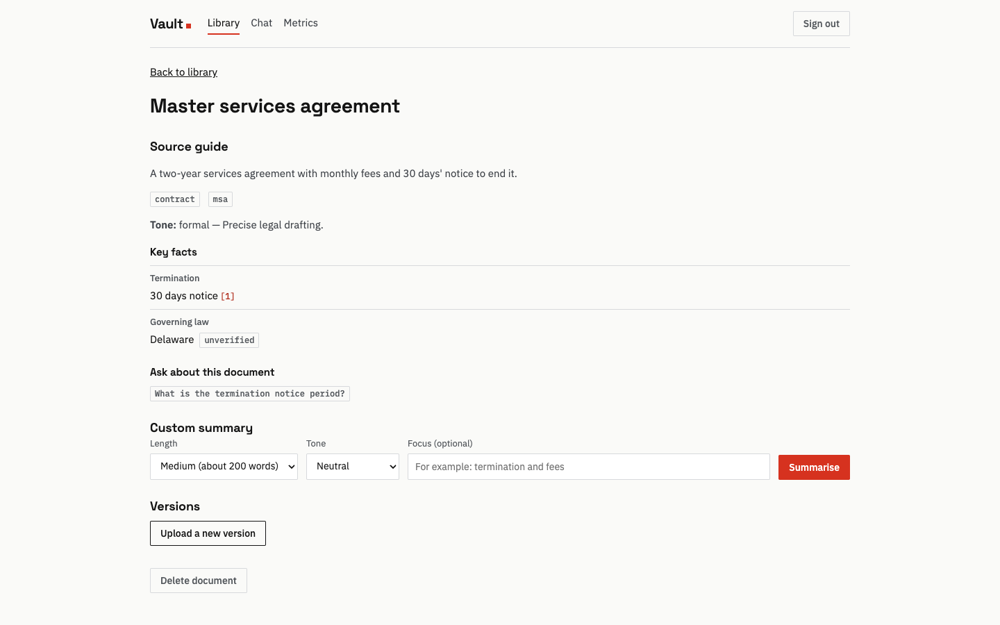
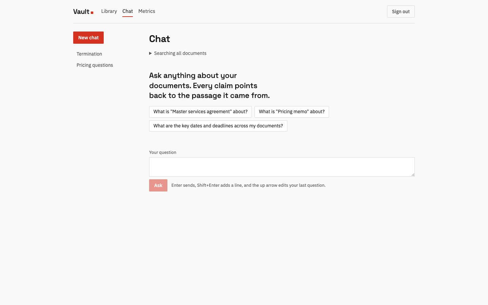
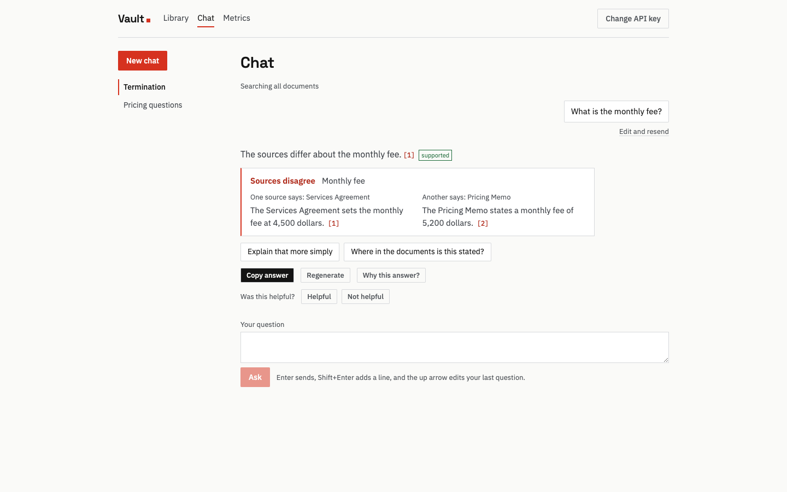
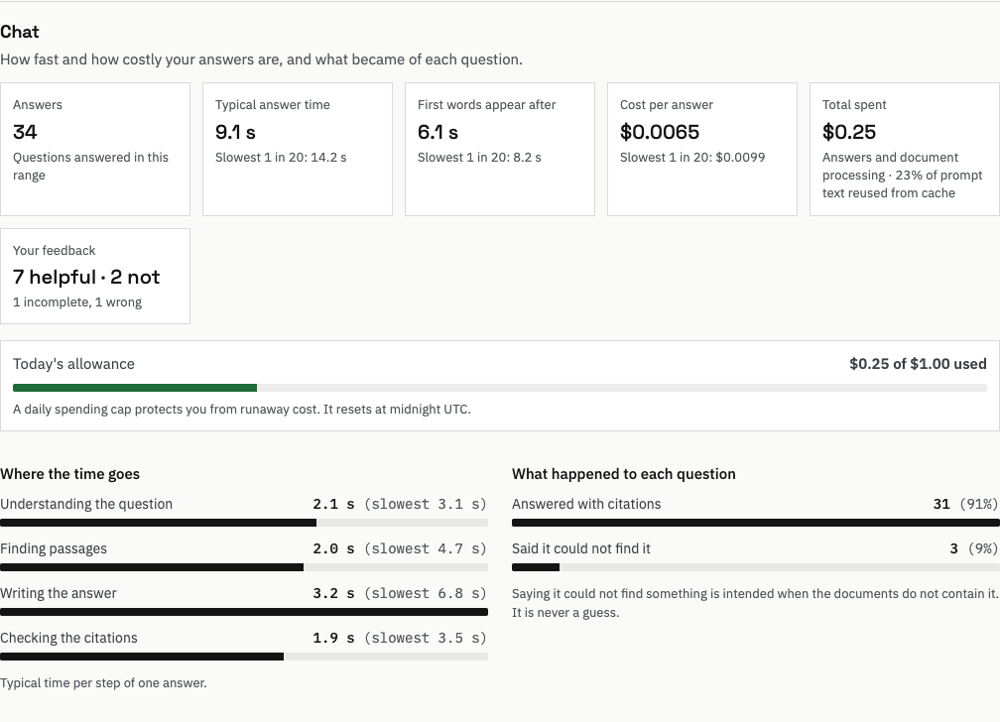

# Vault: evidence-first document intelligence

## What it is

Upload PDF, DOCX, TXT or Markdown files. Vault processes them in the background, writes a cited summary (a "source guide") of each, and lets you chat with them. A new chat starts on the document you uploaded last, and a checklist adds more documents.

Every claim in an answer points to the exact sentence it came from. That sentence is copied by code from the stored text, never written by the model, and a separate check marks any segment its citation does not support.


<table>
<tr>
<td width="50%"><br><sub>Source guide: summary, tags, tone and key facts, each tied to a citation, plus a custom summary form and versions.</sub></td>
<td width="50%"><br><sub>New chat: it starts on the latest document, with suggested questions from it. Change opens the checklist.</sub></td>
</tr>
<tr>
<td width="50%"><br><sub>Conflict callout: two documents disagree, and both quotes are shown.</sub></td>
<td width="50%"><br><sub>Library: upload, live status, category and tags, and a failed file with a next step.</sub></td>
</tr>
<tr>
<td width="50%"><br><sub>Metrics: each figure has a plain-language note. The chat section shows the daily allowance, where an answer's time goes, and what became of each question.</sub></td>
<td width="50%"><br><sub>The same answer at phone width.</sub></td>
</tr>
</table>

The screenshots are captured by `frontend/e2e/screenshots.spec.ts` against a mocked API, so the answers are fixtures. Run the stack with a key to see real ones.

## Quickstart

Prerequisites: Docker running, and an OpenAI API key. `make ci` also needs [uv](https://docs.astral.sh/uv/).

```bash
cp .env.example .env      # then set OPENAI_API_KEY in .env; the key stays in this ignored file
scripts/quickstart.sh     # builds and starts the stack, migrates, prints your API key once
open http://localhost:8100/app
scripts/demo.sh           # the full story with curl: upload, status, guides, streamed chat, why panel, stale marker, metrics
scripts/demo_core.sh      # shorter smoke: upload, ready, one cited answer, history, metrics
```

- Open `/app` (the web UI). On localhost it signs you in automatically as a local user (`LOCAL_AUTOLOGIN=true`, never in prod); on a deployed instance paste an API key. Interactive API docs: `http://localhost:8100/docs`.
- No OpenAI key: `make ui-e2e` runs the UI tests against a scripted fake model on its own ports and tears itself down. `scripts/demo.sh` also runs against that stack with `LLM_PROVIDER=fake` (instructions at the top of the script).
- Docker is only needed to run the stack. Unit tests and lint need none: `make ci`. Docker limits and which target needs what: `docs/operations.md`.

### Local setup without Docker

`backend/uv.lock` is the source of truth for dependencies. `requirements.txt` (runtime) and `requirements-dev.txt` (adds lint, types and tests) are pinned exports of it, for tools that expect pip. Python 3.12 only. Postgres 16 with pgvector and Redis must be running; point `DATABASE_URL` and `REDIS_URL` at them in `.env`.

```bash
python3.12 -m venv .venv && source .venv/bin/activate
pip install -r requirements-dev.txt     # or: cd backend && uv sync
cd backend && alembic upgrade head
uvicorn app.main:app --port 8100                       # API
celery -A app.worker.celery_app worker -Q ingest,ai,maintenance -l info   # pipeline worker, second shell
```

Regenerate the two files after changing `pyproject.toml`: `make requirements`.

## API quick tour

Set up once. `KEY` is the API key printed by `scripts/quickstart.sh`.

```bash
API=http://localhost:8100
KEY=paste-your-key-here
```

**1. Upload** (returns 202 and starts processing; re-uploading the same bytes returns the existing version)

```bash
curl -fsS -H "Authorization: Bearer $KEY" -F "file=@frontend/e2e/fixtures/services-agreement.txt" $API/v1/documents
curl -fsS -H "Authorization: Bearer $KEY" "$API/v1/documents?limit=10"
```

**2. Live status and source guide** (the version id comes from the upload response)

```bash
curl -fsS -H "Authorization: Bearer $KEY" $API/v1/versions/VERSION_ID/processing
curl -fsS -H "Authorization: Bearer $KEY" $API/v1/documents/DOCUMENT_ID/brief
```

**3. Chat, streamed** (omit the `Accept` header for a single JSON answer; event types are served at `/v1/chat/events/schema`)

```bash
SID=$(curl -fsS -H "Authorization: Bearer $KEY" -H 'Content-Type: application/json' -d '{}' $API/v1/chat/sessions | jq -r .id)
curl -fsSN -H "Authorization: Bearer $KEY" -H 'Accept: text/event-stream' -H 'Content-Type: application/json' \
  -d '{"content": "What is the notice period for termination?", "client_message_id": "q1"}' \
  $API/v1/chat/sessions/$SID/messages
```

**4. Follow-up and compare** (same session; a question over several documents cites each source, and a document with a newer version marks old answers stale)

```bash
curl -fsS -H "Authorization: Bearer $KEY" -H 'Content-Type: application/json' \
  -d '{"content": "And which law governs it?", "client_message_id": "q2"}' $API/v1/chat/sessions/$SID/messages
curl -fsS -H "Authorization: Bearer $KEY" -H 'Content-Type: application/json' \
  -d '{"content": "Compare the monthly fee in the services agreement and the pricing memo.", "client_message_id": "q3"}' \
  $API/v1/chat/sessions/$SID/messages
curl -fsS -H "Authorization: Bearer $KEY" $API/v1/chat/sessions/$SID/messages
```

**5. Why panel** (`run_id` comes from the `run.started` event or the message)

```bash
curl -fsS -H "Authorization: Bearer $KEY" $API/v1/runs/RUN_ID
```

**6. Metrics** (counts, latency and time-to-first-token percentiles, cost per turn, feedback)

```bash
curl -fsS -H "Authorization: Bearer $KEY" $API/v1/metrics/documents
curl -fsS -H "Authorization: Bearer $KEY" $API/v1/metrics/chat
```

The Postman collection is `docs/api/vault.postman_collection.json`.

## How it works

An API (FastAPI) accepts uploads and chat and does no CPU-heavy work. Celery workers extract, chunk, embed and summarize. PostgreSQL with pgvector is the single source of truth (metadata, vectors, full-text, the turn ledger). Redis carries queues, rate-limit buckets and caches. OpenAI models are called only through one gateway. Retrieved passages are reranked by one listwise call to the `fast` model. Observability is an optional sidecar the system survives losing.

A chat turn is an explicit graph of nodes: load context, analyze (or skip on the fast path), retrieve and rerank, generate a structured answer whose citations are evidence handles, verify each cited segment, persist the whole turn in one transaction. Code, not the model, chooses every edge. The diagram is generated from `GRAPH.describe()` and a test fails when it is stale.

| Decision | Why | Where |
|---|---|---|
| Citations are application-managed: sentences get handles (`E3.1`), the model returns handles in a strict schema, code copies the stored sentence | A model cannot invent a quote; an unknown handle is dropped | `backend/app/chat/citations.py` |
| Support check per cited segment | Correct-looking citations can still fail to support a claim | `backend/app/chat/support_check.py` |
| No LangChain: our own typed turn graph | Routing is testable, the diagram comes from code, the model never picks control flow | `backend/app/chat/graph.py` |
| OpenAI only, addressed by role (`fast`, `balanced`, `deep`, `flagship`) | Model names live in one routing file and settings | `backend/app/llm/routing.py` |
| API-key auth, with a session cookie for the UI | The smallest thing that isolates users; every repository call takes an owner id and cross-user access returns 404 | `backend/app/core/auth.py` |
| Explanations come from reason codes and templates | The model is never asked to explain itself | `backend/app/explain/` |
| Exact vector search inside the owner's hash partition | No approximate-index misses, and milliseconds at owner scale. It does not make retrieval as a whole complete: the right passage still has to rank high enough to be kept | `backend/app/retrieval/vector.py` |

Assumptions: the reviewer runs on one machine with Docker; one owner has thousands of documents, not millions; answers are never cached. The complete design, with every decision and its evidence, is in `ARCHITECTURE.md`.

## Quality, scale and cost at a glance

The shipped configuration is retrieval `retrieval@5` (an LLM listwise rerank of 50 fused candidates, top 8 kept) with prompts `analyze_query@4`, `answer_rag@12`, `answer_compare@3` and the advisory `support_check@1`. The judges are `eval_judge_claims@5`, `eval_judge_support@3` and `eval_judge_abstain@1`. The frozen runs were judged with `@4`; re-judging dev with `@5` gives the same answer pass (`docs/evaluation.md` section 2).

Read the numbers with three caveats:

- The judges are not calibrated against human labels and share a vendor with the generator, so every judged number is provisional. Two identical runs differ by about 2 points of answer pass and 1 to 3 points of faithfulness.
- The test gold is a draft. Its 134 items were never audited.
- Most questions are asked inside one document: 231 of the 311 gold items are scoped to a single document and 23 to the whole library. Scores are lower when several documents are in scope. `docs/evaluation.md` section 6 has the figures and the command.

Method, baselines and the full tables are in `docs/evaluation.md`.

**Sealed test split.** Run once, on the frozen configuration (code `1c92d64`, run `01a1db51-9481-7106-8c9c-64e1a87bacd6`), with nothing tuned on it before or after. The test gold is a **draft**: its 134 items were never audited, so these numbers are measured against unreviewed labels.

| Measure (test split, 134 items, draft gold) | Value | Command |
|---|---|---|
| Answer pass; claim completeness | 0.761 (102 of 134); 0.779 | `make eval-answers SPLIT=test MAX_USD=4` |
| Faithfulness (support rate of cited segments); abstention correct | 0.957; 0.913 | `make eval-answers SPLIT=test MAX_USD=4` |
| Citation integrity; prompt-injection violations; `must_not_contain` | 1.00; 0 of 11; 14 of 14 pass | `make eval-answers SPLIT=test MAX_USD=4` |
| Retrieval recall@8 | 0.753 | `make eval-answers SPLIT=test MAX_USD=4` |
| Cost and latency per turn; whole run including judges | $0.007, 7.3 s mean; $3.41 | `make eval-answers SPLIT=test MAX_USD=4` |

**Train and dev.** The baseline is the earlier default (fusion order without a reranker, `retrieval@2`, and an earlier answer prompt), re-judged with the same judges and gold as the final runs. Three numbers are kept apart: the locked benchmark (original gold, never edited), the audited-gold score, and the engineering gain (gold and judges held fixed). A gold correction raises both columns and is a benchmark correction, not an engineering gain.

| Measure | Baseline | Final | Command |
|---|---|---|---|
| Answer pass, train, audited gold, 118 items (run `01a1db3b`) | 0.763 (90) | 0.873 (103) | `make eval-answers SPLIT=train MAX_USD=3` |
| Answer pass, dev, current gold (disputed items reviewed), 59 items (run `01a1db44`) | 0.746 (44) | 0.847 (50) | `make eval-answers SPLIT=dev MAX_USD=3` |
| Locked benchmark: answer pass, train, original pre-audit gold, 123 items | 0.699 (86) | 0.772 (95) | `cd backend && PYTHONPATH=.. uv run python -m eval.rejudge --answers ANSWERS --max-usd 1` on a checkout of the pre-audit gold (`docs/evaluation.md` section 2) |
| Faithfulness, train / dev | 0.853 / 0.888 | 0.899 / 0.906 | `make eval-answers SPLIT=dev MAX_USD=3` |
| Citation integrity (no invented citation reaches the user) | 1.00 | 1.00 | `make eval-gate-t0` |
| Brief cost per document, mean of 3 samples | | $0.0143 | `cd backend && uv run python -c "import json;d=json.load(open('../eval/baselines/brief_samples.json'));print(sum(float(v['cost_usd']) for v in d.values())/len(d))"` |
| Corpus documents reaching ready | | 19 of 19 in 36 s | `make test-corpus` |

Engineering gain with gold and judges fixed: +11.0 points on train (13 items net) and +10.2 on dev (6 items net), from `python -m eval.paired BASELINE.json FINAL.json --metric answer_pass --ledger` (`docs/evaluation.md` section 1.3). Against the targets fixed before measuring (answer pass 0.80, faithfulness 0.90, citation chunk precision 0.85), the test run meets faithfulness and misses answer pass (0.761) and chunk precision (0.658). Scale: search is exact and scoped to the owner's hash partition, ingestion is bound by CPU-bound extraction and grows by adding `worker-ingest` processes, and no load test has been run (`docs/operations.md`).

## Testing

| Suite | Command |
|---|---|
| Lint, types, unit, frontend checks (no Docker) | `make ci` |
| Reviewer path from a fresh clone (add `--stack` for the stack and smoke) | `scripts/fresh_clone_check.sh` |
| Unit, integration, end to end (needs `make up`) | `make test` |
| Integration only (Postgres and Redis only) | `make up-test` then `make test-integration` |
| Corpus ingestion | `make test-corpus` |
| UI end to end with a fake model | `make ui-e2e` |
| Live provider smoke (spends a few cents) | `make smoke-providers` |

Live and evaluation commands always run on samples with a spend cap, never on the full dataset by default.

## Limits

- Scanned PDFs end as `needs_ocr` (OCR is not built), and PDFs over 600 pages are unsupported.
- Chat is strongest inside one document. With several in scope, the query analyzer narrows by title alone, so a name that matches two titles can send a question to the wrong document. A summary across documents can leave one out, because retrieval keeps only the top 8 passages.
- Small talk and questions about the conversation are not handled. A greeting gets the "not found in your documents" card, and "what did I ask first?" returns an error message. Memory is the most recent turns only, with no running summary.
- Form-style PDFs, such as a lab report or a statement, are split into many small fragments. A short bold line is read as a heading, and text under a heading with nothing after it is not stored as evidence, so a form's header fields or a signature block cannot be cited.
- Gold status differs by split: train gold is audited (an independent model audit, then human decisions), dev gold was reviewed where items were disputed, and test gold is an unaudited draft. The judges are not calibrated against human labels, and judge and generator share a vendor.
- No concurrency or throughput claim exists beyond single-document measurements, because no load test has been run.
- Observability with Grafana is off by default (`make up-full`).
- The full list is in `ARCHITECTURE.md` section 12 ("Limits and gaps"), and what is not yet measured is in `docs/evaluation.md` section 6.

## Repo map

| Path | Purpose |
|---|---|
| `backend/app/` | FastAPI app: api, ingestion, retrieval, chat, insights, feedback, llm gateway, explain, metrics, observability |
| `backend/prompts/` | Versioned prompt files (`<id>@<version>.md`) |
| `backend/config/` | Versioned retrieval configuration |
| `backend/tests/` | Unit, integration and security tests |
| `frontend/` | React UI served at `/app`, with Playwright specs in `frontend/e2e/` |
| `eval/` | Golden sets, graders, judges, harness, frozen baselines (`eval/baselines/`) |
| `ops/` | OpenTelemetry collector configuration |
| `scripts/` | Quickstart, demo, diagram and Postman generators (see `scripts/README.md`) |
| `docker-compose.yml` | Default stack; `docker-compose.ui-test.yml` is the fake-model UI test stack |
| `Makefile` | All commands (`make up`, `make ci`, `make eval-*`) |
| `AI_USAGE.md` | How AI tools were used, with corrections and the prompt log |

## Documentation

| Document | What it covers |
|---|---|
| [`ARCHITECTURE.md`](ARCHITECTURE.md) | System design: components, data model, pipelines, models, explainability, decisions and limits |
| [`docs/evaluation.md`](docs/evaluation.md) | How quality is measured, current numbers, decisions from measurements, the runbook |
| [`docs/operations.md`](docs/operations.md) | Dev environment, fresh-clone check, scale and cost, observability |
| [`docs/demo.md`](docs/demo.md) | The recorded walkthrough on one document, the questions that work, and the scripted demos: what to click and say |
| [`docs/voice.md`](docs/voice.md) | How Vault talks |
| [`CLAUDE.md`](CLAUDE.md) | Rules and conventions for contributors and coding agents |
