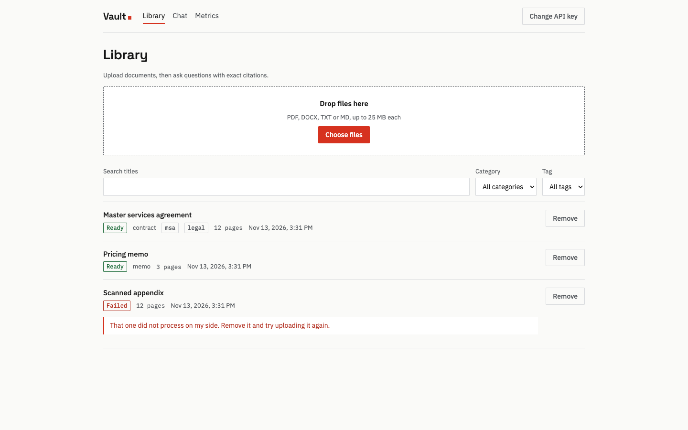

# Vault: evidence-first document intelligence

## What it is

Upload PDF, DOCX, TXT or Markdown files. Vault processes them in the background, writes a cited summary (a "source guide") of each, and lets you chat with your documents, one at a time or across all of them.

Every claim in an answer points to the exact sentence it came from. That sentence is copied by code from the stored text, never written by the model, and a separate check marks any segment its citation does not support.


<table>
<tr>
<td width="50%"><br><sub>Empty chat: suggested questions come from the documents.</sub></td>
<td width="50%"><br><sub>Conflict callout: two documents disagree, both quotes are shown.</sub></td>
</tr>
<tr>
<td width="50%"><br><sub>Library: upload, live status, category and tags, and a failed file with a next step.</sub></td>
<td width="50%"><br><sub>The same answer at phone width.</sub></td>
</tr>
</table>

The screenshots are captured by `frontend/e2e/screenshots.spec.ts` against a scripted fake model, so the answers are fixtures. Run the stack with a key to see real ones.

## Quickstart

```bash
scripts/quickstart.sh     # needs Docker running and OPENAI_API_KEY in .env; prints your API key once
open http://localhost:8100/app
scripts/demo.sh           # the full story with curl: upload, status, guides, streamed chat, why panel, stale marker, metrics
scripts/demo_core.sh      # shorter smoke: upload, ready, one cited answer, history, metrics
```

- Open `/app` (the web UI) and paste the API key `quickstart.sh` printed. Interactive API docs: `http://localhost:8100/docs`.
- No OpenAI key: `make ui-e2e` runs the UI tests against a scripted fake model on its own ports and tears itself down. `scripts/demo.sh` also runs against that stack with `LLM_PROVIDER=fake` (instructions at the top of the script).
- Docker is only needed to run the stack. Unit tests and lint need none: `make ci`. Docker limits and which target needs what: `docs/operations.md`.

## The assignment, feature by feature

Source: `docs/spec/case-study.pdf`. Status is one of **built**, **built, switched off** (the code exists and is disabled until a paired evaluation shows it helps, see `ARCHITECTURE.md` section 7.3) or **not built**.

### Backend components

| Requirement | Status | Where it lives |
|---|---|---|
| Intelligent upload handler: type and size checks, dedupe, idempotency | Built | `POST /v1/documents`; `backend/app/documents/` (magic-byte sniff, 25 MB streaming cap, dedupe on owner and hash) |
| Smart document analysis: extraction, quality checks, OCR-needed detection | Built | `backend/app/ingestion/extract/`, `quality.py`. Scanned pages are flagged `needs_ocr`; OCR itself is not built |
| Asynchronous processing pipeline | Built | `backend/app/ingestion/`: six leased, idempotent stages on Celery with a sweeper (`ARCHITECTURE.md` section 4) |
| Upload and ingestion API, including new versions | Built | `POST /v1/documents`, `POST /v1/documents/{id}/versions`, `GET /v1/versions/{id}/processing` (and `/processing/stream`) |
| Document retrieval API | Built | `GET /v1/documents`, `GET /v1/documents/{id}`, `DELETE /v1/documents/{id}`, `GET /v1/chunks/{id}`, `GET /v1/versions/{id}/file` |
| AI insights API: summary, tags, category, key facts | Built | `GET /v1/documents/{id}/brief`; `backend/app/insights/`. Every fact is quote-verified by code |
| Start chat session | Built | `POST /v1/chat/sessions` |
| Ask a question, with source citations | Built | `POST /v1/chat/sessions/{id}/messages`; `backend/app/chat/` |
| Get chat history | Built | `GET /v1/chat/sessions/{id}/messages` (segments, evidence, follow-ups, stale markers) |
| Multi-turn context | Built | `backend/app/chat/memory.py`: the recent turns, with the question rewritten standalone |
| Document statistics API | Built | `GET /v1/metrics/documents` |
| Processing metrics API | Built | `GET /v1/metrics/processing`, plus `GET /v1/metrics/chat` for turns, latency, cost |
| Data storage: metadata, insights, chats, citations, metrics, performance | Built | `backend/app/db/models/` (`ARCHITECTURE.md` section 3); the cost and run ledger is `llm_calls` and `rag_runs` |

### Technical stack

| Requirement | Status | Where it lives |
|---|---|---|
| Python, FastAPI, PostgreSQL, Celery with Redis | Built | `backend/`, `docker-compose.yml` |
| File processing | Built | pdfplumber and python-docx in `backend/app/ingestion/extract/` |
| OpenAI API: generation and embeddings | Built | Responses API and `text-embedding-3-small`, through one gateway (`backend/app/llm/gateway.py`) |
| Local or S3-compatible storage | Built | Content-addressed local store behind an interface (`backend/app/storage/`) |
| RAG framework (LangChain or LlamaIndex) | Not used, by choice | A typed turn graph of our own, so routing is testable and the model never picks control flow (`backend/app/chat/graph.py`) |
| pytest, API documentation | Built | `backend/tests/`; OpenAPI at `/docs`; Postman collection `docs/api/vault.postman_collection.json` |

### Bonus features

| Feature | Status | Where it lives |
|---|---|---|
| Multi-document chat | Built | `POST /v1/chat/sessions` with `document_ids` for a chosen set, or omitted for all documents; every source is cited |
| Intelligent follow-up suggestions | Built | Returned with each answer and rendered as chips (`backend/app/chat/followups.py`) |
| Summary customization (length, focus, tone) | Built | `POST /v1/documents/{id}/summaries` |
| Automated categorization and tagging | Built | Part of the brief (`category`, `tags`) |
| Key insight extraction | Built | Key facts in `GET /v1/documents/{id}/brief`, each cited and verified in `backend/app/insights/verify.py` |
| Sentiment analysis | Not built | |
| Comparative analysis between documents | Built | Compare route with per-document retrieval and a conflict callout (`backend/app/chat/compare.py`, `conflicts.py`). Per-document quotas and a coverage repair are built, switched off (`CHAT_COMPARE_QUOTA`) |
| Simple frontend | Built | `/app`: library, document page with source viewer, streaming chat, metrics (`frontend/`) |
| Real-time updates | Built, over SSE | `GET /v1/versions/{id}/processing/stream` for processing, `text/event-stream` for chat; no WebSocket |
| Smart caching | Built | Redis caches query embeddings (`backend/app/retrieval/`); chunk embeddings are cached by content hash (`backend/app/ingestion/embed_index.py`); paid ingestion outputs go through `llm_cache`. Answers are deliberately never cached |
| Vector database | Built | pgvector in PostgreSQL: exact search in an owner's hash partition (`backend/app/retrieval/vector.py`) |
| Streaming chat responses | Built | SSE with status stages, per-segment events and time to first token (`backend/app/chat/stream.py`, `events.py`) |
| Comprehensive test coverage | Built | Unit, integration, security and UI end-to-end suites (`make ci`, `make test`, `make ui-e2e`) |
| Cost tracking | Built | One `llm_calls` row per model attempt; cost per turn in `GET /v1/metrics/chat` |
| Rate limiting and quota | Built | Redis token buckets per user and a daily cost quota with 429 and `Retry-After` |
| Document version tracking | Built | `POST /v1/documents/{id}/versions`; answers that cited an old version are marked stale with a one-click re-ask (`backend/app/insights/staleness.py`) |
| Batch processing optimizations | Built | Parallel embedding batches and parallel brief map calls per document (`backend/app/ingestion/embed_index.py`, `backend/app/insights/stage.py`) |
| Detailed logging and observability | Built | JSON logs, OpenTelemetry traces, optional Grafana stack (`make up-full`); `docs/operations.md` section 6 |
| Health check and monitoring endpoints | Built | `GET /healthz`, `GET /readyz`, the metrics APIs |

### Beyond the spec

| Feature | Status | Where it lives |
|---|---|---|
| "Why this answer" panel from reason codes and templates | Built | `GET /v1/runs/{id}`; `backend/app/explain/` |
| Support check per cited segment | Built | `backend/app/chat/support_check.py`; verdicts shown next to each segment |
| Meta questions about your library, answered by owner-scoped SQL | Built | `backend/app/chat/meta.py` |
| Whole-document answering for small scopes | Built, on request only | `backend/app/chat/full_context.py`; automatic use is off (`FULL_CONTEXT_AUTO`), because it showed no gain for twice the cost |
| Evidence gate before answering | Built, switched off | `backend/app/chat/gate.py`; it refused answerable questions |
| Plan-first answers, calculation segments, scored abstention, locate loop, clarification chips, warm voice | Built, switched off | `ARCHITECTURE.md` section 7.3 |
| Accessibility checks on the UI | Built | Automated axe scans and a keyboard-flow test in `frontend/e2e/a11y.spec.ts`; there has been no manual screen-reader audit |

### Deliverables

| Deliverable | Status | Where it lives |
|---|---|---|
| Working backend | Built | `backend/` |
| README with setup, architecture, assumptions, scale | Built | this file, `ARCHITECTURE.md`, `docs/operations.md` |
| AI usage log and prompt engineering | Built | `AI_USAGE.md`; the prompts are `backend/prompts/<id>@<version>.md` |
| Demo of document chat | Script built, recording not included | `scripts/demo.sh`, `scripts/demo_core.sh`, and the narration script in `docs/operations.md` section 7 |

## API quick tour

Set up once. `KEY` is the API key printed by `scripts/quickstart.sh`.

```bash
API=http://localhost:8100
KEY=paste-your-key-here
```

**1. Upload** (returns 202 and starts processing; re-uploading the same bytes returns the existing version)

```bash
curl -fsS -H "Authorization: Bearer $KEY" -F "file=@frontend/e2e/fixtures/services-agreement.txt" $API/v1/documents
curl -fsS -H "Authorization: Bearer $KEY" "$API/v1/documents?limit=10"
```

**2. Live status and source guide** (the version id comes from the upload response)

```bash
curl -fsS -H "Authorization: Bearer $KEY" $API/v1/versions/VERSION_ID/processing
curl -fsS -H "Authorization: Bearer $KEY" $API/v1/documents/DOCUMENT_ID/brief
```

**3. Chat, streamed** (omit the `Accept` header for a single JSON answer; event types are served at `/v1/chat/events/schema`)

```bash
SID=$(curl -fsS -H "Authorization: Bearer $KEY" -H 'Content-Type: application/json' -d '{}' $API/v1/chat/sessions | jq -r .id)
curl -fsSN -H "Authorization: Bearer $KEY" -H 'Accept: text/event-stream' -H 'Content-Type: application/json' \
  -d '{"content": "What is the notice period for termination?", "client_message_id": "q1"}' \
  $API/v1/chat/sessions/$SID/messages
```

**4. Follow-up and compare** (same session; a question over several documents cites each source, and a document with a newer version marks old answers stale)

```bash
curl -fsS -H "Authorization: Bearer $KEY" -H 'Content-Type: application/json' \
  -d '{"content": "And which law governs it?", "client_message_id": "q2"}' $API/v1/chat/sessions/$SID/messages
curl -fsS -H "Authorization: Bearer $KEY" -H 'Content-Type: application/json' \
  -d '{"content": "Compare the monthly fee in the services agreement and the pricing memo.", "client_message_id": "q3"}' \
  $API/v1/chat/sessions/$SID/messages
curl -fsS -H "Authorization: Bearer $KEY" $API/v1/chat/sessions/$SID/messages
```

**5. Why panel** (`run_id` comes from the `run.started` event or the message)

```bash
curl -fsS -H "Authorization: Bearer $KEY" $API/v1/runs/RUN_ID
```

**6. Metrics** (counts, latency and time-to-first-token percentiles, cost per turn, feedback)

```bash
curl -fsS -H "Authorization: Bearer $KEY" $API/v1/metrics/documents
curl -fsS -H "Authorization: Bearer $KEY" $API/v1/metrics/chat
```

The Postman collection is `docs/api/vault.postman_collection.json`.

## How it works

An API (FastAPI) accepts uploads and chat and does no CPU-heavy work. Celery workers extract, chunk, embed and summarize. PostgreSQL with pgvector is the single source of truth (metadata, vectors, full-text, the turn ledger). Redis carries queues, rate-limit buckets and caches. OpenAI models are called only through one gateway. The reranker and observability are optional sidecars the system survives losing.

A chat turn is an explicit graph of nodes: load context, analyze (or skip on the fast path), retrieve, gate the evidence, generate a structured answer whose citations are evidence handles, verify each cited segment, persist the whole turn in one transaction. Code, not the model, chooses every edge. The diagram is generated from `GRAPH.describe()` and a test fails when it is stale.

| Decision | Why | Where |
|---|---|---|
| Citations are application-managed: sentences get handles (`E3.1`), the model returns handles in a strict schema, code copies the stored sentence | A model cannot invent a quote; an unknown handle is dropped | `backend/app/chat/citations.py` |
| Support check per cited segment | Correct-looking citations can still fail to support a claim | `backend/app/chat/support_check.py` |
| No LangChain: our own typed turn graph | Routing is testable, the diagram comes from code, the model never picks control flow | `backend/app/chat/graph.py` |
| OpenAI only, addressed by role (`fast`, `balanced`, `deep`, `flagship`) | Model names live in one routing file and settings | `backend/app/llm/routing.py` |
| API-key auth, with a session cookie for the UI | The smallest thing that isolates users; every repository call takes an owner id and cross-user access returns 404 | `backend/app/core/auth.py` |
| Explanations come from reason codes and templates | The model is never asked to explain itself | `backend/app/explain/` |
| Exact vector search inside the owner's hash partition | Perfect recall and a few milliseconds at owner scale | `backend/app/retrieval/vector.py` |

Assumptions: the reviewer runs on one machine with Docker; one owner has thousands of documents, not millions; answers are never cached. The complete design, with every decision and its evidence, is in `ARCHITECTURE.md`.

## Quality, scale and cost at a glance

Measured on a golden set whose gold labels and judges are not yet reviewed by a person, so judged numbers are **provisional**. Each row names the command that regenerates it; the method and the rest of the numbers are in `docs/evaluation.md`.

| Measure | Value | Command |
|---|---|---|
| Answer pass, train split of 123 items, all switches off | 0.642 | `make eval-answers-v2 SPLIT=train MAX_USD=3` |
| Citation integrity (no invented citation reaches the user) | 1.000 | `make eval-gate-t0` |
| Retrieval recall@8, same run | 0.807 | `make eval-answers-v2 SPLIT=train MAX_USD=3` |
| Answer cost per turn | about $0.006 | `make eval-answers-v2 SPLIT=train MAX_USD=3` |
| Mean answer latency | 5.2 s | `make eval-answers-v2 SPLIT=train MAX_USD=3` |
| Brief cost per document, mean of 3 samples | $0.0143 | `python3 -c "import json;d=json.load(open('eval/baselines/brief_samples.json'));print(sum(float(v['cost_usd']) for v in d.values())/len(d))"` |
| Corpus documents reaching ready | 19 of 19 in 36 s | `make c1-check` |
| Gold quotes locatable in extracted PDFs | 100.0 percent | `make eval-extraction` |

Targets that are not met: answer pass 0.80, faithfulness 0.90, citation precision 0.85. Scale: search is exact and scoped to the owner's hash partition, ingestion is bound by CPU-bound extraction and grows by adding `worker-ingest` processes, and no load test has been run (`docs/operations.md`).

## Testing

| Suite | Command |
|---|---|
| Lint, types, unit, frontend checks (no Docker) | `make ci` |
| Unit, integration, end to end (needs `make up`) | `make test` |
| Integration only (Postgres and Redis only) | `make up-test` then `make test-integration` |
| Corpus ingestion | `make c1-check` |
| UI end to end with a fake model | `make ui-e2e` |
| Live provider smoke (spends a few cents) | `make smoke-providers` |

Live and evaluation commands always run on samples with a spend cap, never on the full dataset by default.

## Limits

- Scanned PDFs end as `needs_ocr` (OCR is not built), and PDFs over 600 pages are unsupported.
- Gold labels are not audited by a person and the judges are not calibrated against human labels. Judge and generator share a vendor.
- No concurrency or throughput claim exists beyond single-document measurements; no load test has been run.
- Optional heavy components are off by default: the reranker (`make up-rerank`; retrieval falls back to fusion order without it) and observability with Grafana (`make up-full`).
- The full list is in `ARCHITECTURE.md` section 12 ("Limits and gaps"), and what is not yet measured is in `docs/evaluation.md` section 6.

## Repo map

| Path | Purpose |
|---|---|
| `backend/app/` | FastAPI app: api, ingestion, retrieval, chat, insights, feedback, llm gateway, explain, metrics, observability |
| `backend/prompts/` | Versioned prompt files (`<id>@<version>.md`) |
| `backend/config/` | Versioned retrieval and abstention configuration |
| `backend/tests/` | Unit, integration and security tests |
| `frontend/` | React UI served at `/app`, with Playwright specs in `frontend/e2e/` |
| `reranker/` | Optional cross-encoder rerank service (`make up-rerank`) |
| `eval/` | Golden sets, graders, judges, harness, frozen baselines (`eval/baselines/`) |
| `ops/` | OpenTelemetry collector configuration |
| `scripts/` | Quickstart, demo, diagram and Postman generators (see `scripts/README.md`) |
| `docker-compose.yml` | Default stack; `docker-compose.ui-test.yml` is the fake-model UI test stack |
| `Makefile` | All commands (`make up`, `make ci`, `make eval-*`) |
| `AI_USAGE.md` | How AI tools were used, with corrections and the prompt log |

## Documentation

| Document | What it covers |
|---|---|
| [`ARCHITECTURE.md`](ARCHITECTURE.md) | System design: components, data model, pipelines, models, explainability, decisions and limits |
| [`docs/evaluation.md`](docs/evaluation.md) | How quality is measured, current numbers, decisions from measurements, the runbook |
| [`docs/operations.md`](docs/operations.md) | Dev environment, scale and cost, observability, demo script |
| [`docs/voice.md`](docs/voice.md) | How Vault talks |
| [`docs/README.md`](docs/README.md) | Index of the documentation tree |
| [`CLAUDE.md`](CLAUDE.md) | Rules and conventions for contributors and coding agents |
